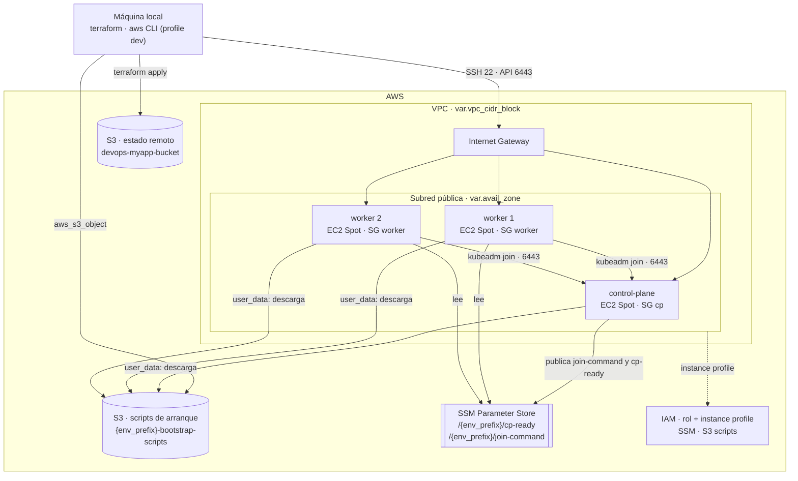
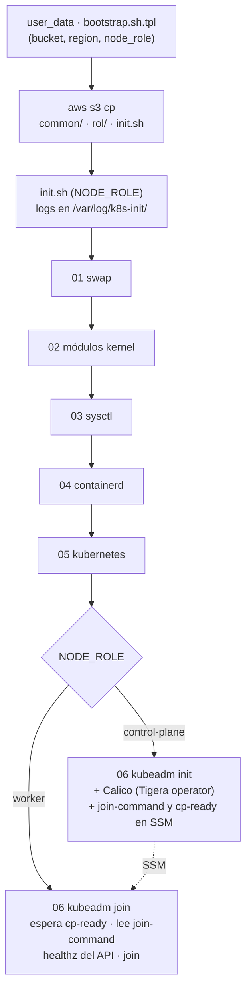
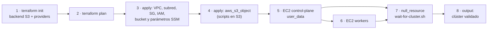

# terraform-practice

> Clúster Kubernetes (kubeadm) de 3 nodos en AWS (1 control-plane y 2 workers en EC2 Spot sobre Amazon Linux 2023), desplegado con Terraform: bootstrap por S3, coordinación de nodos por SSM Parameter Store y validación automática del clúster al final del `terraform apply`.

<!-- TODO (logos): simple-icons 16.36.0 (la versión que usa shields.io) no incluye logos de AWS ni de Calico, por eso los badges de Instancias, Compra, Calico, VXLAN, Coordinación, AWS CLI e IAM van sin logo. Provider AWS y Backend usan el logo de Terraform porque son componentes de Terraform. Para añadir logos oficiales: ?logo=data:image/svg+xml;base64,<SVG_EN_BASE64>&logoColor=white -->
<!-- VERIFICAR: el badge "Worker" y todo el README asumen 2 workers (count = 2 en aws_instance.worker, instances.tf). -->


## Índice

1. [Guía rápida de lectura](#guía-rápida-de-lectura)
2. [Decisiones de ingeniería](#decisiones-de-ingeniería)
3. [Arquitectura](#arquitectura)
4. [Estructura del repositorio](#estructura-del-repositorio)
5. [Requisitos](#requisitos)
6. [Inicio rápido](#inicio-rápido)
7. [Variables de entorno](#variables-de-entorno)
8. [Endpoints / uso](#endpoints--uso)
9. [Build y ejecución en producción](#build-y-ejecución-en-producción)
10. [Comandos útiles](#comandos-útiles)
11. [Resolución de problemas](#resolución-de-problemas)
12. [Seguridad](#seguridad)
13. [Limitaciones conocidas y próximos pasos](#limitaciones-conocidas-y-próximos-pasos)
14. [Licencia](#licencia)

## Guía rápida de lectura

Orden recomendado para revisar el repositorio en unos 15 minutos:

| # | Fichero | Qué muestra |
|---|---|---|
| 1 | `instances.tf` | IAM acotado, instance profile, EC2 Spot, `depends_on` contra los objetos S3 y parámetros SSM de limpieza |
| 2 | `scripts/bootstrap.sh.tpl` y `scripts/init.sh` | `user_data` mínimo y orquestador por fases con logs y fallo rápido |
| 3 | `scripts/control-plane/06-kubeadm-init.sh` y `scripts/worker/06-kubeadm-join.sh` | Protocolo de coordinación entre nodos vía SSM |
| 4 | `s3_scripts.tf` | Distribución de scripts: `file()` frente a `templatefile()` y `etag` |
| 5 | `security_group_rules.tf` | Reglas por rol, con referencias entre Security Groups |
| 6 | `wait.tf` y `scripts/wait-for-cluster.sh` | `apply` que no termina hasta que el clúster está sano |
| 7 | `scripts/common/01…05-*.sh` | Verificación al final de cada fase |
| 8 | `providers.tf` y `variables.tf` | Versiones y contrato de entrada |

> **Alcance:** este README documenta solo lo que está en los ficheros del repositorio. Lo marcado con ⚠️ o con comentarios `VERIFICAR` no se ha comprobado.

## Decisiones de ingeniería

| Área | Decisión | Beneficio |
|---|---|---|
| Bootstrap | `user_data` mínimo (`bootstrap.sh.tpl`) que solo recibe `bucket`, `region` y `node_role`, descarga los scripts de S3 y lanza `init.sh` | La lógica vive en ficheros revisables y versionados, no embebida en el `user_data` |
| Orquestación | `init.sh` ejecuta las fases 01–06 con log propio en `/var/log/k8s-init/` y aborta con el código de salida de la primera fase que falla | Diagnóstico por fase y sin estados a medias |
| Verificación | Cada fase comprueba su resultado: swap inactivo y `fstab` sin swap, módulos con `lsmod`, sysctl a 1, `SystemdCgroup = true`, socket de containerd y binarios en `PATH` | Los errores salen en la fase que los causa |
| Runtime | `SystemdCgroup = true` se escribe antes de `enable --now containerd`, y `dnf update` excluye `kernel*` | Evita desajuste de cgroups entre kubelet y containerd, y no invalida los módulos cargados en la fase 02 |
| Plantillas | `templatefile()` solo en los 3 scripts con variables (05, 06 control-plane, 06 worker); el resto con `file()` | Superficie de plantilla mínima. `etag` detecta cambios al reaplicar |
| Red del control-plane | `kubeadm init` con `--apiserver-advertise-address` = IP privada y `--apiserver-cert-extra-sans` = IP pública, ambas leídas por IMDSv2 | Tráfico interno por IP privada y acceso externo con certificado válido |
| Coordinación | El control-plane publica `/<env_prefix>/join-command` (SecureString) y `/<env_prefix>/cp-ready` en SSM; los workers hacen polling con timeout | Sin SSH entre nodos ni provisioners. El join command va cifrado y los workers pueden arrancar antes que el control-plane |
| Robustez del join | El worker valida el formato del join command y consulta `/healthz` del API Server antes de `kubeadm join` | Falla con un mensaje claro en vez de un join colgado |
| IAM | Un rol con `AmazonSSMManagedInstanceCore`, SSM acotado a `parameter/<env_prefix>/*` y S3 acotado al bucket de scripts | Alcance limitado por ruta y por bucket. No hay credenciales en las instancias |
| Firewall | Un SG por rol. Reglas como recursos `aws_vpc_security_group_{ingress,egress}_rule`. El tráfico interno usa `referenced_security_group_id`, no CIDR | Reglas auditables una a una e independientes del direccionamiento |
| Coste | EC2 Spot con `max_price` parametrizable y `instance_interruption_behavior = "terminate"` | Coste reducido para laboratorio |
| Ciclo de vida | `aws_ssm_parameter` con `ignore_changes = [value]` y bucket con `force_destroy = true` | `terraform destroy` limpia los parámetros que publican los nodos y el bucket. El `apply` no pisa los valores publicados |
| Validación | `null_resource` ejecuta `wait-for-cluster.sh` (SSM, SSH y nodos Ready) y el output `wait_for_cluster` depende de él | El `apply` solo termina bien con el clúster verificado |
| Estado | Backend remoto en S3 | El estado no depende de un equipo local |
| CNI | Calico v3.28.0 vía Tigera operator, `VXLANCrossSubnet` y CIDR de pods por variable | Instalación declarativa. ⚠️ El modo de encapsulación tiene un riesgo sin verificar (ver [Limitaciones](#limitaciones-conocidas-y-próximos-pasos)) |

## Arquitectura

> **Topología:** 3 nodos = 1 control-plane + 2 workers (`count = 2` en `aws_instance.worker`). `wait.tf` espera 3 nodos con un valor fijo, independiente de `count`.

### Infraestructura y red



### Arranque de un nodo



<!-- TODO: añadir captura real de la consola de EC2 con los 3 nodos -->


### Componentes (según los ficheros)

| Capa | Configuración |
|---|---|
| IaC | Terraform `>= 1.6`, providers `aws ~> 6.0` y `null ~> 3.0` |
| Estado | S3 `devops-myapp-bucket`, key `myapp/state.tfstate`, región `eu-south-2`, profile `dev` |
| Provider AWS | Solo `profile = "dev"`. No fija `region` |
| Red | VPC y subred pública (`var.*`), Internet Gateway y route table propia con `0.0.0.0/0` hacia el IGW |
| Cómputo | Spot, `var.instance_type` (sin default), IP pública en todos los nodos, disco raíz de 30 GB `gp3` con `delete_on_termination = true` |
| SO | AMI más reciente de Amazon Linux 2023 x86_64 (filtro `al2023-ami-*-x86_64`, owner `amazon`) |
| Kubernetes | kubeadm, kubelet y kubectl del repositorio `pkgs.k8s.io/core:/stable:/<k8s_version>/rpm/`, sin pin de parche |
| Runtime | containerd desde `dnf`, versión sin fijar |
| CNI | Calico v3.28.0 (Tigera operator) con `VXLANCrossSubnet`, `blockSize: 26`, `natOutgoing: Enabled` |
| Coordinación | SSM Parameter Store (`cp-ready`, `join-command`) |
| Validación | `null_resource.wait_for_cluster` con `local-exec` |

## Estructura del repositorio

```text
terraform-bootcamp/
├── .gitignore                  # .terraform, *.tfstate, *.tfstate.*, *.tfvars
├── iac-k8s.md                  # notas de uso (terraform init / apply)
├── instances.tf                # AMI, IAM, key pair, EC2 control-plane y workers, parámetros SSM
├── main.tf                     # provider (profile), VPC, subred, IGW, route tables
├── outputs.tf                  # IPs, comandos SSH, estado de validación, coste estimado
├── providers.tf                # versiones requeridas y backend S3
├── s3_scripts.tf               # bucket de scripts y aws_s3_object por script
├── security_group.tf           # SG control-plane y SG worker
├── security_group_rules.tf     # reglas de entrada y salida
├── variables.tf                # variables de entrada
├── wait.tf                     # null_resource que valida el clúster
└── scripts/
    ├── bootstrap.sh.tpl        # user_data: descarga de S3 y lanzamiento de init.sh
    ├── init.sh                 # orquestador de fases con logs
    ├── wait-for-cluster.sh     # validación desde la máquina local (SSM, SSH, nodos Ready)
    ├── common/
    │   ├── 01-swap.sh
    │   ├── 02-kernel-modules.sh
    │   ├── 03-sysctl.sh
    │   ├── 04-containerd.sh
    │   └── 05-kubernetes.sh    # plantilla Terraform (k8s_version)
    ├── control-plane/
    │   └── 06-kubeadm-init.sh  # plantilla Terraform: kubeadm init, Calico, SSM
    └── worker/
        └── 06-kubeadm-join.sh  # plantilla Terraform: espera SSM, healthz, join
```

## Requisitos

| Requisito | Versión | Estado |
|---|---|---|
| Terraform | `>= 1.6` | ✅ `required_version` en `providers.tf` |
| Provider `hashicorp/aws` | `~> 6.0` | ✅ `providers.tf` |
| Provider `hashicorp/null` | `~> 3.0` | ✅ `providers.tf` |
| Calico (Tigera operator) | `v3.28.0` | ✅ URL del manifiesto en `06-kubeadm-init.sh` |
| Kubernetes | `var.k8s_version`, formato `v1.NN` según la URL del repositorio | ⚠️ Sin default. El comentario de `variables.tf` sugiere `v1.36`; no he comprobado que exista en `pkgs.k8s.io` |
| AMI | Amazon Linux 2023 x86_64 | ✅ Filtro en `instances.tf`. ⚠️ AMI concreta no verificada |
| containerd | El que sirva `dnf` en AL2023 | ⚠️ Sin versión fijada |
| AWS CLI (local) | No especificada | ⚠️ Lo usan `wait-for-cluster.sh` y el profile `dev` |
| AWS CLI (nodos) | No especificada | ⚠️ `bootstrap.sh.tpl` asume que viene en la AMI |
| `bash` y `ssh` (local) | No especificada | ⚠️ Los usa `wait.tf` mediante `local-exec` |
| Profile AWS `dev` | — | Lo usan el provider, el backend y `wait.tf` (valor fijo) |
| Bucket de estado `devops-myapp-bucket` | Ya existente en `eu-south-2` | Terraform no lo crea |
| Par de claves SSH | Rutas por `var.public_key_location` y `var.private_key_location` | Los defaults apuntan a una ruta personal; sustitúyelos |

El profile debe poder crear VPC, EC2, IAM, S3 y SSM, y leer y escribir el estado en el bucket del backend.

## Inicio rápido

1. Clona el repositorio.

   ```bash
   git clone <URL_DEL_REPOSITORIO> terraform-bootcamp
   cd terraform-bootcamp
   ```

2. Comprueba las credenciales del profile `dev` y el bucket del backend.

   ```bash
   aws sts get-caller-identity --profile dev
   aws s3api head-bucket --bucket devops-myapp-bucket --profile dev
   ```

3. Crea `terraform.tfvars` (`.gitignore` lo excluye). Sustituye los marcadores `<...>`.

   ```terraform
   env_prefix        = "<prefijo>"            # nombra los recursos; el bucket será <prefijo>-bootstrap-scripts
   aws_region        = "<región>"
   avail_zone        = "<zona-de-disponibilidad>"
   vpc_cidr_block    = "<cidr-vpc>"
   subnet_cidr_block = "<cidr-subred>"
   instance_type     = "<tipo-instancia>"     # mínimo 2 CPU / 2 GB según variables.tf
   k8s_version       = "<v1.NN>"              # rama stable de pkgs.k8s.io
   pod_network_cidr  = "<cidr-pods>"          # no debe solapar con vpc_cidr_block

   # Obligatorias pero sin uso: el data source de la AMI tiene estos valores fijos
   image_name        = "al2023-ami-*-x86_64"
   owner             = "amazon"

   # Opcionales
   # spot_max_price        = "0.04"
   # public_key_location   = "<ruta>/id_ed25519.pub"
   # private_key_location  = "<ruta>/id_ed25519"
   ```

4. Confirma que el número de workers es 2 (topología de 3 nodos).

   ```bash
   grep -n "count" instances.tf   # esperado: count = 2 en aws_instance.worker
   ```

   <!-- VERIFICAR: en la versión revisada del código aparecía count = 1; con 3 nodos debe ser 2 -->

5. Inicializa, revisa y aplica.

   ```bash
   terraform init
   terraform plan
   terraform apply
   ```

   El `apply` no termina hasta que el clúster está validado. La espera máxima sin errores es de unos 25 minutos (ver [tiempos de espera](#build-y-ejecución-en-producción)).

   <!-- TODO: añadir captura real del output final del apply -->
   

6. Comprueba el clúster.

   ```bash
   CP_IP=$(terraform output -raw control_plane_public_ip)
   ssh -i <RUTA_CLAVE_PRIVADA> ec2-user@"$CP_IP" "kubectl get nodes -o wide"
   ```

   <!-- TODO: añadir captura real de kubectl get nodes con 3 nodos Ready -->
   

7. Destruye los recursos cuando termines.

   ```bash
   terraform destroy
   ```

   El bucket de estado del backend no lo gestiona este proyecto y no se elimina.

---

## Variables de entorno

El repositorio no contiene `.env` ni ficheros de entorno. Hay tres niveles de variables.

### Variables de Terraform (`variables.tf`)

| Variable | Obligatoria | Default | Uso |
|---|---|---|---|
| `env_prefix` | Sí | — | Prefijo de recursos, ruta SSM `/<env_prefix>/*` y nombre del bucket de scripts |
| `aws_region` | Sí | — | ARN de la política SSM y `--region` en los scripts. ⚠️ No se aplica al bloque `provider` |
| `avail_zone` | Sí | — | Subred e instancias |
| `vpc_cidr_block` | Sí | — | CIDR de la VPC |
| `subnet_cidr_block` | Sí | — | CIDR de la subred pública |
| `instance_type` | Sí | — | Tipo de instancia de todos los nodos |
| `k8s_version` | Sí | — | Rama del repositorio de Kubernetes (script 05) |
| `pod_network_cidr` | Sí | — | `kubeadm init --pod-network-cidr` y CIDR del `Installation` de Calico |
| `spot_max_price` | No | `"0.04"` | Precio máximo Spot en USD/hora **por instancia** |
| `public_key_location` | No | `/home/<usuario>/.ssh/id_ed25519.pub` | Clave pública del `aws_key_pair` |
| `private_key_location` | No | `/home/<usuario>/.ssh/id_ed25519` | Clave privada que usa `wait-for-cluster.sh` |
| `image_name` | Sí | — | ⚠️ Declarada pero sin uso |
| `owner` | Sí | — | ⚠️ Declarada pero sin uso |

### Variables inyectadas en los scripts (`templatefile`)

| Script | Variables |
|---|---|
| `bootstrap.sh.tpl` | `bucket`, `region`, `node_role` |
| `common/05-kubernetes.sh` | `k8s_version` |
| `control-plane/06-kubeadm-init.sh` | `pod_network_cidr`, `env_prefix`, `aws_region` |
| `worker/06-kubeadm-join.sh` | `env_prefix`, `aws_region` |

### Variables de entorno y parámetros en ejecución

| Nombre | Dónde | Valor / uso |
|---|---|---|
| `NODE_ROLE` | `bootstrap.sh.tpl` hacia `init.sh` | `control-plane` o `worker`. Cualquier otro valor aborta |
| `KUBECONFIG` | `06-kubeadm-init.sh` | `/etc/kubernetes/admin.conf` |
| `HOME` | `wait-for-cluster.sh` | Origen del default de la clave SSH |

Parámetros posicionales de `wait-for-cluster.sh`:

| Pos. | Nombre | Default |
|---|---|---|
| 1 | IP pública del control-plane | obligatorio |
| 2 | `env_prefix` | obligatorio |
| 3 | región | obligatorio |
| 4 | clave SSH | `$HOME/.ssh/id_ed25519` |
| 5 | nodos esperados | `3` |
| 6 | profile AWS | `default` (`wait.tf` pasa `dev`) |

## Endpoints / uso

El repositorio no despliega ninguna aplicación ni Ingress. El servicio es el propio clúster.

### Puertos expuestos (Security Groups)

| Endpoint | Puerto | Origen permitido |
|---|---|---|
| SSH al control-plane: `ec2-user@<CP_PUBLIC_IP>` | 22/tcp | `0.0.0.0/0` |
| API Server: `https://<CP_PUBLIC_IP>:6443` | 6443/tcp | `0.0.0.0/0` y SG worker |
| SSH a los workers: `ec2-user@<WORKER_PUBLIC_IP>` | 22/tcp | `0.0.0.0/0` |
| NodePort: `<WORKER_PUBLIC_IP>:<30000-32767>` | 30000–32767/tcp | `0.0.0.0/0` (solo SG worker) |
| kubelet | 10250/tcp | SG CP hacia CP y workers |
| etcd | 2379–2380/tcp | SG CP (self) |
| kube-proxy health | 10256/tcp | SG worker (self) |
| Calico VXLAN | 4789/udp | CP↔workers, CP↔CP y worker↔worker |
| BGP | 179/tcp | CP↔workers, CP↔CP y worker↔worker |
| Calico Typha | 5473/tcp | SG worker hacia SG CP |
| Salida | todos | `0.0.0.0/0` |

### Outputs de Terraform

| Output | Contenido | Nota |
|---|---|---|
| `control_plane_public_ip` | IP pública del control-plane | — |
| `control_plane_private_ip` | IP privada del control-plane | — |
| `worker_public_ips` | IPs públicas de los workers | — |
| `worker_private_ips` | IPs privadas de los workers | ⚠️ La descripción dice "públicas" |
| `ssh_control_plane` | Comando SSH al control-plane | ⚠️ Ruta de la clave privada fija en el código |
| `wait_for_cluster` | Mensaje de clúster validado | Depende de `null_resource.wait_for_cluster` |
| `watch_init_log` | `tail -f` del log de init por SSH | ⚠️ Usa `var.public_key_location` como identidad en vez de la clave privada |
| `estimated_cost_per_hour` | Texto fijo `~$0.081 USD/hr total (3 nodos Spot c7i-flex.large)` | ⚠️ No se calcula; no depende de `instance_type` |

### Uso de kubectl

`kubectl` ya está configurado para `ec2-user` en el control-plane (`/home/ec2-user/.kube/config`).

```bash
ssh -i <RUTA_CLAVE_PRIVADA> ec2-user@<CP_PUBLIC_IP>
kubectl get nodes -o wide
```

Desde tu máquina local (⚠️ comportamiento de kubeadm no verificado en este repo): copia el kubeconfig y cambia `server:` a la IP pública, que está en los SAN del certificado.

```bash
scp -i <RUTA_CLAVE_PRIVADA> ec2-user@<CP_PUBLIC_IP>:/home/ec2-user/.kube/config ./kubeconfig
# Editar server: -> https://<CP_PUBLIC_IP>:6443
KUBECONFIG=./kubeconfig kubectl get nodes
```

## Build y ejecución en producción

No hay artefactos que construir (ni imágenes ni binarios). El "build" es el ciclo de Terraform. Tampoco hay CI/CD en el repositorio ni un entorno de producción definido. En su estado actual es un laboratorio: ver [Seguridad](#seguridad) y [Limitaciones](#limitaciones-conocidas-y-próximos-pasos) antes de usarlo con cargas reales.



```bash
terraform init
terraform plan
terraform apply
```

`iac-k8s.md` usa `terraform apply -auto-approve`. Evítalo fuera de pruebas desechables.

### Tiempos de espera

| Quién | Espera | Límite |
|---|---|---|
| `wait-for-cluster.sh`, fase 1 (`cp-ready` en SSM) | 40 × 30 s | 20 min |
| `wait-for-cluster.sh`, fase 2 (SSH) | 20 × 10 s | 200 s |
| `wait-for-cluster.sh`, fase 3 (nodos Ready) | 30 × 10 s | 5 min |
| Worker: `cp-ready` en SSM | 40 × 30 s | 20 min |
| Worker: `/healthz` del API | 30 × 5 s | 2,5 min |
| Control-plane: socket de containerd | 30 × 5 s | 2,5 min |
| Control-plane: `tigera-operator` | 24 × 15 s | 6 min |
| Control-plane: API Server local | 30 × 5 s | 2,5 min |

## Comandos útiles

```bash
# Terraform (desde la raíz del repo)
terraform fmt -check -recursive
terraform validate
terraform output
terraform output -raw control_plane_public_ip
terraform apply -replace='aws_instance.worker[0]'     # recrear un worker
terraform apply -replace=aws_instance.control_plane   # recrear el control-plane
```

```bash
# En el control-plane (por SSH)
kubectl get nodes -o wide
kubectl get pods -A -o wide
kubectl get pods -n calico-system -o wide

# Logs de arranque (init.sh escribe uno por fase)
sudo tail -f /var/log/k8s-init/init.log
sudo ls /var/log/k8s-init/
sudo cat /var/log/k8s-init/04-containerd.log
```

```bash
# Estado de coordinación en SSM
aws ssm get-parameter --name "/<env_prefix>/cp-ready" \
  --query "Parameter.Value" --output text --region <región> --profile dev

aws ssm get-parameter --name "/<env_prefix>/join-command" --with-decryption \
  --query "Parameter.Value" --output text --region <región> --profile dev
```

```bash
# Regenerar el join command (ejecutar en el control-plane)
JOIN_CMD=$(sudo kubeadm token create --print-join-command)
aws ssm put-parameter --name "/<env_prefix>/join-command" --value "$JOIN_CMD" \
  --type SecureString --overwrite --region <región>
```

```bash
# Repetir la validación manualmente
chmod +x scripts/wait-for-cluster.sh
./scripts/wait-for-cluster.sh <CP_PUBLIC_IP> <env_prefix> <región> <RUTA_CLAVE_PRIVADA> 3 dev
```

## Resolución de problemas

Los mensajes son los que emiten los scripts del repositorio.

| Síntoma | Causa probable | Solución |
|---|---|---|
| `apply` falla en `null_resource.wait_for_cluster` con `Timeout: solo X/3 nodos Ready` | Hay menos de 3 nodos (`count` de workers distinto de 2, porque el `3` de `wait.tf` es fijo), un worker no se unió o no se lanzó el Spot | `kubectl get nodes` en el CP; revisa `/var/log/k8s-init/06-worker.log` en el worker; alinea `count` con `wait.tf` y reaplica |
| `Timeout: control plane no señalizó en 20 minutos` | El bootstrap del CP falló: p. ej. `aws s3 cp` sin permisos (las instancias no dependen de las políticas IAM), repo de Kubernetes inalcanzable o `kubeadm init` fallido | SSH al CP, `sudo tail -n 100 /var/log/k8s-init/init.log` y el log de la fase que falló. Si fue S3/IAM: `terraform apply -replace=aws_instance.control_plane` |
| `Timeout: SSH no disponible` | SG, IP pública o clave privada que no corresponde a la pública registrada | Comprueba que `private_key_location` es la pareja de `public_key_location`; prueba `ssh -v` |
| `ERROR: K8S_VERSION está vacía` (fase 05) | `k8s_version` vacía | Defínela en `terraform.tfvars` |
| `ERROR: repositorio kubernetes no disponible` (fase 05) | `k8s_version` no existe en `pkgs.k8s.io` o el nodo no tiene salida a Internet | Verifica el formato `v1.NN` y que la rama exista; revisa la salida del SG |
| `ERROR: tigera-operator no disponible tras 6 minutos` | Sin acceso a `raw.githubusercontent.com` o el operador no arranca | `kubectl get pods -n tigera-operator` en el CP; revisa egress y recursos del nodo |
| Worker: `No se pudo establecer conexión ... /healthz` | SG, CP caído o `join-command` de un CP anterior | Revisa 6443 desde el SG worker y el estado del CP. Regenera el join command (ver [Comandos útiles](#comandos-útiles)) |
| Un worker reemplazado no se une | El `join-command` de SSM es antiguo o el token caducó (kubeadm: 24 h por defecto) | Regenera el token y actualiza SSM |
| Nodos Ready pero los pods de nodos distintos no se alcanzan | ⚠️ Hipótesis sin verificar: `VXLANCrossSubnet` con una sola subred no encapsula, y los SG solo abren 4789/udp, 179/tcp y 5473/tcp | `kubectl get pods -n calico-system -o wide`; prueba ping o curl entre pods en nodos distintos. Si falla, prueba `encapsulation: VXLAN` |
| `kubectl` remoto falla con error de certificado o conexión | El kubeconfig apunta a la IP privada | Cambia `server:` a `https://<CP_PUBLIC_IP>:6443` |
| `terraform init` falla en el backend | El bucket `devops-myapp-bucket` no existe o el profile no tiene acceso | Crea el bucket o ajusta permisos |
| `BucketAlreadyExists` al crear el bucket de scripts | `<env_prefix>-bootstrap-scripts` es un nombre global | Cambia `env_prefix` |
| `InsufficientInstanceCapacity` o petición Spot no cumplida | Sin capacidad Spot para el tipo en la AZ, o `spot_max_price` por debajo del precio | Sube `spot_max_price`, cambia de tipo o de AZ |
| `watch_init_log` falla por clave | Usa la clave pública como identidad | Usa `ssh -i <RUTA_CLAVE_PRIVADA> ec2-user@<CP_PUBLIC_IP> 'tail -f /var/log/k8s-init/init.log'` |

## Seguridad

### Controles presentes

- El join command se guarda como `SecureString` en SSM. No se pasa por `user_data` ni por SSH.
- IAM acotado: SSM a `parameter/<env_prefix>/*` y S3 solo al bucket de scripts.
- El bucket de scripts bloquea el acceso público (`aws_s3_bucket_public_access_block`).
- No hay credenciales en el código: el provider y el backend usan el profile local `dev`.
- `.gitignore` excluye `.terraform`, `*.tfstate`, `*.tfstate.*` y `*.tfvars`.
- Los puertos internos (kubelet, etcd, kube-proxy, Calico) se abren por referencia de SG, no por CIDR.

### Riesgos abiertos

| Severidad | Riesgo | Dónde | Mitigación propuesta |
|---|---|---|---|
| Alta | SSH (22) abierto a `0.0.0.0/0` en CP y workers | `cp_ssh`, `worker_ssh` | Variable con CIDR de administración o SSM Session Manager (el rol ya incluye `AmazonSSMManagedInstanceCore`) |
| Alta | API Server (6443) abierto a `0.0.0.0/0`. La descripción y el comentario dicen "restringido" | `cp_k8s_api` | Variable `/32` o VPN y corregir la descripción |
| Alta | NodePorts 30000–32767 abiertos a Internet | `worker_nodeport` | Restringir el origen o usar un balanceador |
| Media | Nodos en subred pública con IP pública | `instances.tf`, `main.tf` | Subred privada con NAT, o acceso solo por SSM |
| Media | Backend sin `encrypt` ni locking (`dynamodb_table` / `use_lockfile`). Nombre genérico que puede compartirse con otro proyecto | `providers.tf` | Activar cifrado y locking; key específica del proyecto |
| Media | Un único rol IAM para CP y workers: los workers pueden escribir `cp-ready` y `join-command` | `instances.tf` | Roles separados; workers solo con lectura |
| Media | IMDSv2 usado en scripts pero no exigido (no hay `metadata_options`) | `instances.tf` | `http_tokens = "required"` |
| Media | Discos raíz sin `encrypted` explícito | `instances.tf` | `encrypted = true` |
| Baja | `ec2:DescribeVolumes*` sobre `*` sin uso visible en los scripts | `instances.tf` | Eliminar si no se usa |
| Baja | `StrictHostKeyChecking=no` en `wait-for-cluster.sh` y `curl -k` en el healthz del worker | scripts | Aceptable en laboratorio; endurecer para producción |
| Baja | `.gitignore` no cubre `kubeconfig`, `*.pem`, `*.tfvars.json` ni `crash.log` | `.gitignore` | Ampliarlo. El kubeconfig contiene credenciales de administrador |
| Baja | Rutas personales en defaults y outputs | `variables.tf`, `outputs.tf` | Sustituir por variables o rutas relativas |

## Limitaciones conocidas y próximos pasos

| Prioridad | Limitación | Próximo paso |
|---|---|---|
| 1 | El número de nodos está duplicado: `count` en `instances.tf` y `3` fijo en `wait.tf`. El output de coste también dice "3 nodos" como texto | Derivar `EXPECTED_NODES` de `1 + length(aws_instance.worker)` o de una variable `worker_count` |
| 1 | ⚠️ Calico `VXLANCrossSubnet` con una sola subred, y SG con puertos puntuales entre nodos. `source_dest_check` queda en su valor por defecto. La validación solo mira `Ready`, no la conectividad de pods | Añadir un test pod↔pod entre nodos al script de validación; evaluar `encapsulation: VXLAN` |
| 1 | Las instancias no dependen de `aws_iam_role_policy*` ni de la attachment SSM. El bootstrap usa `set -euo pipefail` y no reintenta `aws s3 cp` | Añadir esas dependencias en `depends_on` y reintentos en `bootstrap.sh.tpl` |
| 2 | Estado SSM obsoleto: `cp-ready` queda en `true` y `join-command` conserva el último token (24 h por defecto). Un nodo Spot reemplazado puede leer valores viejos | Regenerar el token al relanzar nodos, o publicar un token con TTL ajustado |
| 2 | Un único control-plane Spot con etcd en el disco raíz y sin backup: una interrupción pierde el clúster | Control-plane On-Demand o varios CP, y backup de etcd |
| 2 | `provider "aws"` sin `region`, mientras scripts e IAM usan `var.aws_region` | Fijar `region = var.aws_region` |
| 2 | `image_name` y `owner` son obligatorias pero no se usan. El filtro de AMI es amplio y `most_recent` no es reproducible | Usarlas en el data source y fijar la AMI o su patrón completo |
| 2 | Typha: la regla solo permite workers→CP. Si el pod cae en un worker, faltaría tráfico hacia los workers | Revisar con `kubectl get pods -n calico-system -o wide` y completar la regla o quitarla |
| 2 | Reglas CP↔CP (etcd, kubelet, VXLAN, BGP) pensadas para HA, innecesarias con un solo control-plane | Mantener solo las necesarias o activar HA |
| 3 | Cambiar un script en S3 no relanza las instancias, porque el `user_data` no cambia | Añadir un hash de los scripts al `user_data` o a un `triggers` |
| 3 | `04-containerd.sh` hace `dnf update` completo en cada arranque. Sin pin de kubelet, kubeadm ni containerd. Calico fijo en `v3.28.0` mientras `k8s_version` es variable | Fijar versiones y contrastar la matriz de compatibilidad |
| 3 | Comentarios contradictorios sobre el CIDR de pods (`10.244.0.0/16` y `192.168.0.0/16`). El Installation CR usa la variable | Documentar un único valor recomendado y que no solape con la VPC |
| 3 | `wait-for-cluster.sh`: `NODES_RETRIES` y `NODES_INTERVAL` definidos pero sin uso (el bucle usa 30 y 10 literales); cabecera con 4 parámetros y acepta 6; `grep -c ... \|\| echo "0"` puede devolver dos líneas | Limpiar el script y cubrirlo con `shellcheck` |
| 3 | Sin pipeline CI/CD ni validaciones automáticas (`validate`, `tflint`, análisis de seguridad) | Añadir un pipeline con `fmt`, `validate`, `tflint` y un escáner de IaC |

## Licencia

No hay fichero `LICENSE` en el repositorio.

<!-- TODO: elegir una licencia y añadir el fichero LICENSE -->
