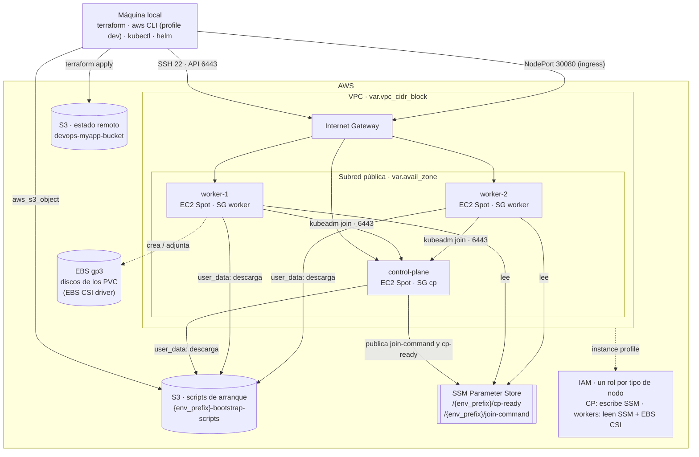
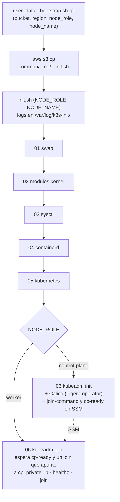
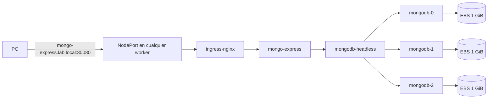
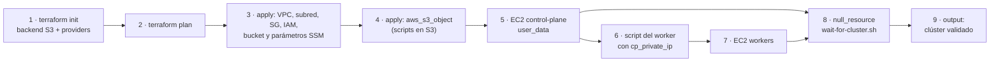

# terraform-practice

> Clúster Kubernetes (kubeadm) de 3 nodos en AWS (1 control-plane y 2 workers en EC2 Spot sobre Amazon Linux 2023), desplegado con Terraform: bootstrap por S3, coordinación de nodos por SSM Parameter Store y validación automática del clúster al final del `terraform apply`. Incluye un laboratorio guiado de MongoDB con Helm (StatefulSet de 3 réplicas sobre discos EBS), ingress-nginx y mongo-express, con destrucción controlada de lo que Terraform no gestiona.

<!-- TODO (logos): simple-icons 16.36.0 (la versión que usa shields.io) no incluye logos de AWS ni de Calico, por eso los badges de Instancias, Compra, Calico, VXLAN, Coordinación, AWS CLI e IAM van sin logo. Provider AWS y Backend usan el logo de Terraform porque son componentes de Terraform. Para añadir logos oficiales: ?logo=data:image/svg+xml;base64,<SVG_EN_BASE64>&logoColor=white -->


## Índice

1. [Guía rápida de lectura](#guía-rápida-de-lectura)
2. [Decisiones de ingeniería](#decisiones-de-ingeniería)
3. [Arquitectura](#arquitectura)
4. [Estructura del repositorio](#estructura-del-repositorio)
5. [Requisitos](#requisitos)
6. [Inicio rápido](#inicio-rápido)
7. [Laboratorio: MongoDB con Helm](#laboratorio-mongodb-con-helm)
8. [Variables de entorno](#variables-de-entorno)
9. [Endpoints / uso](#endpoints--uso)
10. [Build y ejecución en producción](#build-y-ejecución-en-producción)
11. [Comandos útiles](#comandos-útiles)
12. [Resolución de problemas](#resolución-de-problemas)
13. [Seguridad](#seguridad)
14. [Limitaciones conocidas y próximos pasos](#limitaciones-conocidas-y-próximos-pasos)
15. [Licencia](#licencia)

## Guía rápida de lectura

Orden recomendado para revisar el repositorio en unos 15 minutos:

| # | Fichero | Qué muestra |
|---|---|---|
| 1 | `iam.tf` | Un rol por tipo de nodo con mínimo privilegio: el control-plane publica en SSM y los workers solo leen. Los workers llevan además la política del EBS CSI driver |
| 2 | `instances.tf` | EC2 Spot, IMDSv2 obligatorio, `depends_on` contra IAM y objetos S3, y parámetros SSM de coordinación |
| 3 | `scripts/bootstrap.sh.tpl` y `scripts/init.sh` | `user_data` mínimo y orquestador por fases con logs y fallo rápido |
| 4 | `scripts/control-plane/06-kubeadm-init.sh` y `scripts/worker/06-kubeadm-join.sh` | Protocolo de coordinación entre nodos vía SSM, con rechazo de `join-command` obsoletos |
| 5 | `locals.tf` y `s3_scripts.tf` | Distribución de scripts: `file()` frente a `templatefile()` y `etag` |
| 6 | `security_group_rules.tf` | Reglas por rol, con referencias entre Security Groups |
| 7 | `wait.tf` y `scripts/wait-for-cluster.sh` | `apply` que no termina hasta que el clúster está sano |
| 8 | `docs/lab-k8s-mongodb-helm.md`, `k8s/` y `scripts/k8s-teardown.sh` | Laboratorio guiado con Helm y destrucción de lo que Terraform no controla |

> **Alcance:** este README documenta solo lo que está en los ficheros del repositorio. Lo marcado con ⚠️ no se ha comprobado. Lo marcado como *validado* se probó en un despliegue real el 2026-11-25.

## Decisiones de ingeniería

| Área | Decisión | Beneficio |
|---|---|---|
| Bootstrap | `user_data` mínimo (`bootstrap.sh.tpl`) que solo recibe `bucket`, `region`, `node_role` y `node_name`, descarga los scripts de S3 y lanza `init.sh` | La lógica vive en ficheros revisables y versionados, no embebida en el `user_data` |
| Orquestación | `init.sh` ejecuta las fases 01–06 con log propio en `/var/log/k8s-init/` y aborta con el código de salida de la primera fase que falla | Diagnóstico por fase y sin estados a medias |
| Verificación | Cada fase comprueba su resultado: swap inactivo y `fstab` sin swap, módulos con `lsmod`, sysctl a 1, `SystemdCgroup = true`, socket de containerd y binarios en `PATH` | Los errores salen en la fase que los causa |
| Runtime | `SystemdCgroup = true` se escribe antes de `enable --now containerd`, y `dnf update` excluye `kernel*` | Evita desajuste de cgroups entre kubelet y containerd, y no invalida los módulos cargados en la fase 02 |
| Plantillas | `templatefile()` solo en los 3 scripts con variables (05, 06 control-plane, 06 worker), renderizados en `locals.tf`; el resto con `file()` | Superficie de plantilla mínima. `etag` detecta cambios al reaplicar |
| Red del control-plane | `kubeadm init` con `--apiserver-advertise-address` = IP privada y `--apiserver-cert-extra-sans` = IP pública, ambas leídas por IMDSv2 | Tráfico interno por IP privada y acceso externo con certificado válido |
| Nombres de nodo | `control-plane`, `worker-1`, `worker-2` vía `NODE_NAME` en `kubeadm init/join` | Nombres estables y legibles en `kubectl get nodes` |
| Coordinación | El control-plane publica `/<env_prefix>/join-command` (SecureString) y `/<env_prefix>/cp-ready` en SSM; los workers hacen polling con timeout | Sin SSH entre nodos ni provisioners. El join command va cifrado y los workers pueden arrancar antes que el control-plane |
| Robustez del join | El worker recibe la IP privada del control-plane (`locals.tf`) y solo acepta un `join-command` que apunte a `<cp_private_ip>:6443`; además valida el formato y consulta `/healthz` del API Server antes de `kubeadm join` | Si SSM conserva el join de un clúster anterior, el worker espera al nuevo en vez de fallar (validado sustituyendo el control-plane) |
| IAM | Un rol por tipo de nodo. Control-plane: `ssm:PutParameter` solo sobre sus 2 parámetros. Workers: `ssm:GetParameter` sobre los mismos y `AmazonEBSCSIDriverPolicyV2`. Ambos: `AmazonSSMManagedInstanceCore` y S3 de solo lectura acotado a sus prefijos | Mínimo privilegio: un worker no puede escribir el join. No hay credenciales en las instancias |
| Metadatos | `metadata_options` con `http_tokens = "required"` y `http_put_response_hop_limit = 2` | IMDSv2 obligatorio y accesible desde pods (lo necesita el EBS CSI driver) |
| Firewall | Un SG por rol. Reglas como recursos `aws_vpc_security_group_{ingress,egress}_rule`. El tráfico interno usa `referenced_security_group_id`, no CIDR | Reglas auditables una a una e independientes del direccionamiento |
| Coste | EC2 Spot con `max_price` parametrizable y `instance_interruption_behavior = "terminate"`. El output `estimated_cost_per_hour` se calcula con la configuración | Coste reducido para laboratorio |
| Ciclo de vida | `aws_ssm_parameter` con `ignore_changes = [value]` y bucket con `force_destroy = true` | `terraform destroy` limpia los parámetros que publican los nodos y el bucket. El `apply` no pisa los valores publicados |
| Validación | `null_resource` ejecuta `wait-for-cluster.sh` (SSM, SSH y nodos Ready). El número de nodos esperado se calcula como `1 + length(aws_instance.worker)` | El `apply` solo termina bien con el clúster verificado y sin números duplicados |
| Estado | Backend remoto en S3 | El estado no depende de un equipo local |
| CNI | Calico v3.28.0 vía Tigera operator, encapsulación `VXLAN` y CIDR de pods por variable | Tráfico entre pods de distintos nodos validado (mongo-express en `worker-1` → MongoDB en `worker-2`) |
| Fuera de Terraform | Las apps del laboratorio se instalan con Helm desde un `custom-values.yaml` versionado por chart, y `scripts/k8s-teardown.sh` destruye lo que Terraform no conoce (releases, PVC y discos EBS) | Valores sobrescritos trazables en git y cero recursos huérfanos |

## Arquitectura

> **Topología:** 3 nodos = 1 control-plane + 2 workers (`count = 2` en `aws_instance.worker`). Todos `c7i-flex.large` (2 vCPU, 4 GiB).

### Infraestructura y red



### Arranque de un nodo



<!-- TODO: añadir captura real de la consola de EC2 con los 3 nodos (docs/img/ no existe todavía) -->


### Componentes (según los ficheros)

| Capa | Configuración |
|---|---|
| IaC | Terraform `>= 1.6`, providers `aws ~> 6.0` y `null ~> 3.0` |
| Estado | S3 `devops-myapp-bucket`, key `myapp/state.tfstate`, región `eu-south-2`, profile `dev` |
| Provider AWS | `profile = var.aws_profile` y `region = var.aws_region` |
| Red | VPC y subred pública (`var.*`), Internet Gateway y route table propia con `0.0.0.0/0` hacia el IGW |
| Cómputo | Spot. `var.cp_instance_type` y `var.worker_instance_type` (default `c7i-flex.large`), IP pública en todos los nodos, disco raíz `gp3` de `var.root_volume_size` GB con `delete_on_termination = true`, IMDSv2 obligatorio con salto 2 |
| SO | AMI más reciente que cumpla `var.image_name` y `var.owner` (en `terraform.tfvars`: `al2023-ami-2023.*-kernel-6.1-x86_64` / `amazon`) |
| Kubernetes | kubeadm, kubelet y kubectl del repositorio `pkgs.k8s.io/core:/stable:/<k8s_version>/rpm/`, sin pin de parche (validado: `v1.36` → `v1.36.6`) |
| Runtime | containerd desde `dnf`, versión sin fijar |
| CNI | Calico v3.28.0 (Tigera operator) con `VXLAN`, `blockSize: 26`, `natOutgoing: Enabled` |
| Coordinación | SSM Parameter Store (`cp-ready`, `join-command`) |
| Validación | `null_resource.wait_for_cluster` con `local-exec` |
| Laboratorio | AWS EBS CSI driver 2.68.1, ingress-nginx 4.15.1, MongoDB (Bitnami) 16.5.45, mongo-express 7.0.0 (ver [Laboratorio](#laboratorio-mongodb-con-helm)) |

## Estructura del repositorio

```text
terraform-bootcamp/
├── .gitignore                  # .terraform, *.tfstate, *.tfvars, tfplan, runbook local
├── README.md
├── iam.tf                      # roles, políticas e instance profiles por tipo de nodo
├── instances.tf                # AMI, key pair, EC2 control-plane y workers, parámetros SSM
├── locals.tf                   # scripts renderizados con templatefile() y nodos esperados
├── main.tf                     # provider (profile, region), VPC, subred, IGW, route tables
├── outputs.tf                  # IPs, comandos SSH, estado de validación, coste estimado
├── providers.tf                # versiones requeridas y backend S3
├── s3_scripts.tf               # bucket de scripts y aws_s3_object por script
├── security_group.tf           # SG control-plane y SG worker
├── security_group_rules.tf     # reglas de entrada y salida
├── variables.tf                # variables de entrada
├── wait.tf                     # null_resource que valida el clúster
├── iac-k8s.md                  # notas antiguas de uso (terraform init / apply)
├── entry-script.sh             # ⚠️ de una etapa anterior; no lo usa el código raíz
├── modules/webserver/          # ⚠️ de una etapa anterior; no lo usa el código raíz
├── docs/
│   └── lab-k8s-mongodb-helm.md # guía del laboratorio MongoDB / Helm
├── k8s/
│   ├── 01-nginx-deployment/nginx.yaml        # único manifiesto propio (Deployment de prueba)
│   ├── aws-ebs-csi-driver/custom-values.yaml # driver EBS + StorageClass gp3
│   ├── ingress-nginx/custom-values.yaml      # NodePort 30080/30443
│   ├── mongodb/custom-values.yaml            # replica set de 3, imágenes bitnamilegacy
│   └── mongo-express/custom-values.yaml      # interfaz web con login e Ingress
└── scripts/
    ├── bootstrap.sh.tpl        # user_data: descarga de S3 y lanzamiento de init.sh
    ├── init.sh                 # orquestador de fases con logs
    ├── wait-for-cluster.sh     # validación desde la máquina local (SSM, SSH, nodos Ready)
    ├── setup-kubeconfig.sh     # kubectl local: KUBECONFIG combinado con minikube
    ├── k8s-teardown.sh         # destruye lo que Terraform no controla (Helm, PVC, EBS)
    ├── common/
    │   ├── 01-swap.sh
    │   ├── 02-kernel-modules.sh
    │   ├── 03-sysctl.sh
    │   ├── 04-containerd.sh
    │   └── 05-kubernetes.sh    # plantilla Terraform (k8s_version)
    ├── control-plane/
    │   └── 06-kubeadm-init.sh  # plantilla Terraform: kubeadm init, Calico, SSM
    └── worker/
        └── 06-kubeadm-join.sh  # plantilla Terraform: espera SSM, valida la IP del CP, healthz, join
```

## Requisitos

| Requisito | Versión | Estado |
|---|---|---|
| Terraform | `>= 1.6` | ✅ `required_version` en `providers.tf` |
| Provider `hashicorp/aws` | `~> 6.0` | ✅ `providers.tf` |
| Provider `hashicorp/null` | `~> 3.0` | ✅ `providers.tf` |
| Calico (Tigera operator) | `v3.28.0` | ✅ URL del manifiesto en `06-kubeadm-init.sh` |
| Kubernetes | `var.k8s_version`, formato `v1.NN` | ✅ Validado con `v1.36` (instala `v1.36.6`). Sin default |
| AMI | Amazon Linux 2023 x86_64 | ✅ Filtro por `var.image_name` / `var.owner` |
| containerd | El que sirva `dnf` en AL2023 | ⚠️ Sin versión fijada |
| AWS CLI (local) | No especificada | La usan `wait-for-cluster.sh`, `k8s-teardown.sh` y el profile `dev` |
| AWS CLI (nodos) | No especificada | `bootstrap.sh.tpl` asume que viene en la AMI |
| `bash`, `ssh`, `kubectl` (local) | No especificada | `wait.tf` (`local-exec`), `setup-kubeconfig.sh` y `k8s-teardown.sh` |
| Helm (local) | `v4.x` (validado `v4.3.1`) | Solo para el laboratorio |
| Profile AWS `dev` | — | Lo usan el provider (`var.aws_profile`), el backend (fijo) y `wait.tf` |
| Bucket de estado `devops-myapp-bucket` | Ya existente en `eu-south-2` | Terraform no lo crea |
| Par de claves SSH | Rutas por `var.public_key_location` y `var.private_key_location` | Los defaults apuntan a una ruta personal; sustitúyelos |
| Cuota Spot de la cuenta | ≥ 6 vCPU (la cuenta validada tiene **8**) | Código de cuota `L-34B43A08`. Ver [Resolución de problemas](#resolución-de-problemas) |

El profile debe poder crear VPC, EC2, IAM, S3 y SSM, y leer y escribir el estado en el bucket del backend.

## Inicio rápido

1. Clona el repositorio.

   ```bash
   git clone <URL_DEL_REPOSITORIO> terraform-bootcamp
   cd terraform-bootcamp
   ```

2. Comprueba las credenciales del profile `dev` y el bucket del backend.

   ```bash
   aws sts get-caller-identity --profile dev
   aws s3api head-bucket --bucket devops-myapp-bucket --profile dev
   ```

3. Crea `terraform.tfvars` (`.gitignore` lo excluye). Sustituye los marcadores `<...>`.

   ```terraform
   env_prefix           = "<prefijo>"            # nombra los recursos; el bucket será <prefijo>-bootstrap-scripts
   aws_region           = "<región>"
   avail_zone           = "<zona-de-disponibilidad>"
   vpc_cidr_block       = "<cidr-vpc>"
   subnet_cidr_block    = "<cidr-subred>"
   k8s_version          = "<v1.NN>"              # rama stable de pkgs.k8s.io
   pod_network_cidr     = "<cidr-pods>"          # no debe solapar con vpc_cidr_block
   root_volume_size     = 12                     # GB; mínimo el snapshot de la AMI
   image_name           = "al2023-ami-2023.*-kernel-6.1-x86_64"
   owner                = "amazon"

   # Opcionales (con default)
   # cp_instance_type     = "c7i-flex.large"
   # worker_instance_type = "c7i-flex.large"   # 4 GB: necesario para el laboratorio
   # aws_profile          = "dev"
   # spot_max_price       = "0.04"
   # public_key_location  = "<ruta>/id_ed25519.pub"
   # private_key_location = "<ruta>/id_ed25519"
   ```

4. Inicializa, revisa y aplica.

   ```bash
   terraform init
   terraform plan -out=tfplan      # esperado: Plan: 56 to add
   terraform apply tfplan
   ```

   El `apply` no termina hasta que el clúster está validado. La espera máxima sin errores es de unos 25 minutos (ver [tiempos de espera](#tiempos-de-espera)). En la práctica, unos 10 minutos.

   <!-- TODO: añadir captura real del output final del apply -->
   

5. Configura `kubectl` en tu máquina (convive con minikube; ver [Uso de kubectl](#uso-de-kubectl)).

   ```bash
   source scripts/setup-kubeconfig.sh
   kubectl get nodes
   ```

   <!-- TODO: añadir captura real de kubectl get nodes con 3 nodos Ready -->
   

6. Destruye los recursos cuando termines, **en este orden**.

   ```bash
   scripts/k8s-teardown.sh              # releases de Helm, PVC y discos EBS (fuera de Terraform)
   terraform destroy                    # esperado: Resources: 56 destroyed
   scripts/k8s-teardown.sh --sweep-only # barrido final de discos huérfanos en AWS
   ```

   El bucket de estado del backend no lo gestiona este proyecto y no se elimina.

---

## Laboratorio: MongoDB con Helm

Guía completa paso a paso, con las salidas reales: **[docs/lab-k8s-mongodb-helm.md](docs/lab-k8s-mongodb-helm.md)** (validada de principio a fin el 2026-11-25).

| Paso | Qué se practica | Archivo |
|---|---|---|
| 1 | Deployment: aplicar, escalar, *rolling update*, `rollout undo`, autocuración | `k8s/01-nginx-deployment/nginx.yaml` (único manifiesto propio) |
| 2 | Discos EBS dinámicos: StorageClass `gp3` por defecto, cifrada, `WaitForFirstConsumer`, `reclaimPolicy: Delete` | `k8s/aws-ebs-csi-driver/custom-values.yaml` (chart 2.68.1) |
| 3 | Ingress expuesto por NodePort fijo 30080/30443 (sin balanceador) | `k8s/ingress-nginx/custom-values.yaml` (chart 4.15.1) |
| 4 | MongoDB como StatefulSet de 3 réplicas (replica set `rs0`), un PVC de 1 GiB por réplica, *failover* y persistencia | `k8s/mongodb/custom-values.yaml` (chart 16.5.45) |
| 5 | mongo-express detrás del Ingress, con login obligatorio | `k8s/mongo-express/custom-values.yaml` (chart 7.0.0) |
| 6 | Destrucción sin huérfanos | `scripts/k8s-teardown.sh` |

Cada `custom-values.yaml` lleva en su cabecera el chart, la **versión fijada**, el comando de instalación y el motivo de cada valor sobrescrito. **Ningún archivo contiene contraseñas**: MongoDB genera la suya en un Secret y mongo-express la recibe con `--set`.



**Avisos:**

- ⚠️ Desde agosto de 2025 Bitnami solo publica gratis imágenes **`bitnamilegacy`**, congeladas y sin parches de seguridad. El chart de MongoDB está fijado en **16.5.45**, la última versión cuyas imágenes de serie existen en `bitnamilegacy`. Solo para laboratorio.
- ⚠️ **ingress-nginx se retiró en marzo de 2026** y mongo-express está descontinuado: solo para pruebas.
- **Los discos de los PVC los crea Kubernetes, no Terraform**: `terraform destroy` no los borra. `scripts/k8s-teardown.sh` desinstala las releases, borra los PVC, espera a que el driver elimine los discos y, después, barre AWS buscando discos con las etiquetas `Project=<env_prefix>` y `ManagedBy=aws-ebs-csi-driver` (los discos raíz de Terraform no las llevan). Devuelve `1` si queda algo.

## Variables de entorno

El repositorio no contiene `.env` ni ficheros de entorno. Hay tres niveles de variables.

### Variables de Terraform (`variables.tf`)

| Variable | Obligatoria | Default | Uso |
|---|---|---|---|
| `env_prefix` | Sí | — | Prefijo de recursos, ruta SSM `/<env_prefix>/*` y nombre del bucket de scripts |
| `aws_region` | Sí | — | Región del provider y `--region` en los scripts |
| `aws_profile` | No | `"dev"` | Profile del provider y de `wait.tf` |
| `avail_zone` | Sí | — | Subred e instancias |
| `vpc_cidr_block` | Sí | — | CIDR de la VPC |
| `subnet_cidr_block` | Sí | — | CIDR de la subred pública |
| `cp_instance_type` | No | `"c7i-flex.large"` | Tipo del control-plane (debe ser elegible para Free Tier en la cuenta) |
| `worker_instance_type` | No | `"c7i-flex.large"` | Tipo de los workers (4 GB, necesario para el laboratorio) |
| `root_volume_size` | Sí | — | Disco raíz en GB (mínimo el snapshot de la AMI) |
| `k8s_version` | Sí | — | Rama del repositorio de Kubernetes (script 05) |
| `pod_network_cidr` | Sí | — | `kubeadm init --pod-network-cidr` y CIDR del `Installation` de Calico |
| `spot_max_price` | No | `"0.04"` | Precio máximo Spot en USD/hora **por instancia** |
| `public_key_location` | No | `/home/<usuario>/.ssh/id_ed25519.pub` | Clave pública del `aws_key_pair` |
| `private_key_location` | No | `/home/<usuario>/.ssh/id_ed25519` | Clave privada que usan `wait-for-cluster.sh` y los outputs SSH |
| `image_name` | Sí | — | Patrón de nombre de la AMI |
| `owner` | Sí | — | Propietario de la AMI |

### Variables inyectadas en los scripts (`templatefile`)

| Script | Variables |
|---|---|
| `bootstrap.sh.tpl` | `bucket`, `region`, `node_role`, `node_name` |
| `common/05-kubernetes.sh` | `k8s_version` |
| `control-plane/06-kubeadm-init.sh` | `pod_network_cidr`, `env_prefix`, `aws_region` |
| `worker/06-kubeadm-join.sh` | `env_prefix`, `aws_region`, `cp_private_ip` |

### Variables de entorno en ejecución

| Nombre | Dónde | Valor / uso |
|---|---|---|
| `NODE_ROLE`, `NODE_NAME` | `bootstrap.sh.tpl` hacia `init.sh` | `control-plane` / `worker` y nombre del nodo. Otro rol aborta |
| `KUBECONFIG` | `06-kubeadm-init.sh` | `/etc/kubernetes/admin.conf` |
| `KUBECONFIG` | `setup-kubeconfig.sh` (máquina local) | `~/.kube/config:~/.kube/<contexto>.conf` |

Entradas de `wait-for-cluster.sh` (las pasa `wait.tf` como variables de entorno):

| Variable | Obligatoria | Default |
|---|---|---|
| `CP_IP` | Sí | — |
| `ENV_PREFIX` | Sí | — |
| `AWS_REGION` | Sí | — |
| `EXPECTED_NODES` | Sí | `wait.tf`: `1 + length(aws_instance.worker)` |
| `AWS_PROFILE` | No | El de la AWS CLI |
| `SSH_KEY` / `SSH_USER` | No | `$HOME/.ssh/id_ed25519` / `ec2-user` |
| `SSM_RETRIES`/`SSM_INTERVAL`, `SSH_RETRIES`/`SSH_INTERVAL`, `NODES_RETRIES`/`NODES_INTERVAL` | No | `40/30`, `20/10`, `30/10` |

Variables opcionales de `setup-kubeconfig.sh`: `K8S_CONTEXT` (`dev-k8s`), `SSH_KEY`, `SSH_USER`, `RC_FILE` (`~/.zshrc`), `NO_PERSIST`, `TF_DIR`. De `k8s-teardown.sh`: `K8S_CONTEXT`, `ENV_PREFIX` (`dev-k8s`), `AWS_PROFILE` (`dev`), `AWS_REGION` (`eu-south-2`), `PV_WAIT_SECONDS` (`300`) y las opciones `--yes` y `--sweep-only`.

## Endpoints / uso

El servicio base es el propio clúster. El [laboratorio](#laboratorio-mongodb-con-helm) despliega además ingress-nginx y mongo-express, accesibles por NodePort.

### Puertos expuestos (Security Groups)

| Endpoint | Puerto | Origen permitido |
|---|---|---|
| SSH al control-plane: `ec2-user@<CP_PUBLIC_IP>` | 22/tcp | `0.0.0.0/0` |
| API Server: `https://<CP_PUBLIC_IP>:6443` | 6443/tcp | `0.0.0.0/0` y SG worker |
| SSH a los workers: `ec2-user@<WORKER_PUBLIC_IP>` | 22/tcp | `0.0.0.0/0` |
| NodePort: `<WORKER_PUBLIC_IP>:<30000-32767>` (ingress del laboratorio: 30080/30443) | 30000–32767/tcp | `0.0.0.0/0` (solo SG worker) |
| kubelet | 10250/tcp | SG cp hacia CP y workers |
| etcd | 2379–2380/tcp | SG cp (self) |
| kube-proxy health | 10256/tcp | SG worker (self) |
| Calico VXLAN | 4789/udp | CP↔workers, CP↔CP y worker↔worker |
| BGP | 179/tcp | CP↔workers, CP↔CP y worker↔worker |
| Calico Typha | 5473/tcp | Workers→CP, CP→workers y worker↔worker |
| Salida | todos | `0.0.0.0/0` |

### Outputs de Terraform

| Output | Contenido |
|---|---|
| `control_plane_public_ip` | IP pública del control-plane |
| `control_plane_private_ip` | IP privada del control-plane |
| `worker_public_ips` | IPs públicas de los workers (orden = `worker-1`, `worker-2`) |
| `worker_private_ips` | IPs privadas de los workers |
| `ssh_control_plane` | Comando SSH al control-plane (usa `var.private_key_location`) |
| `wait_for_cluster` | Mensaje de clúster validado. Depende de `null_resource.wait_for_cluster` |
| `watch_init_log` | `tail -f` del log de init por SSH |
| `estimated_cost_per_hour` | Tope de coste calculado: tipos de instancia, número de workers y `spot_max_price` × nodos |

### Uso de kubectl

En el control-plane, `kubectl` ya está configurado para `ec2-user` (`/home/ec2-user/.kube/config`):

```bash
$(terraform output -raw ssh_control_plane)
kubectl get nodes -o wide
```

Desde tu máquina local (validado), después de cada `apply`:

```bash
source scripts/setup-kubeconfig.sh
```

El script descarga el kubeconfig por SSH, lo guarda en `~/.kube/dev-k8s.conf` (permisos `600`) apuntando a la IP pública, que está en los SAN del certificado, con clúster, usuario y contexto `dev-k8s`. Además deja `KUBECONFIG=~/.kube/config:~/.kube/dev-k8s.conf` en la terminal y en `~/.zshrc`. **Convive con minikube**: `~/.kube/config` nunca se reescribe y solo cambia su `current-context`. Para cambiar de clúster: `kubectl config use-context minikube` / `dev-k8s`.

## Build y ejecución en producción

No hay artefactos que construir (ni imágenes ni binarios). El "build" es el ciclo de Terraform. Tampoco hay CI/CD en el repositorio ni un entorno de producción definido. En su estado actual es un laboratorio: ver [Seguridad](#seguridad) y [Limitaciones](#limitaciones-conocidas-y-próximos-pasos) antes de usarlo con cargas reales.



```bash
terraform init
terraform plan -out=tfplan
terraform apply tfplan
```

`iac-k8s.md` usa `terraform apply -auto-approve`. Evítalo fuera de pruebas desechables.

### Tiempos de espera

| Quién | Espera | Límite |
|---|---|---|
| `wait-for-cluster.sh`, fase 1 (`cp-ready` en SSM) | 40 × 30 s | 20 min |
| `wait-for-cluster.sh`, fase 2 (SSH) | 20 × 10 s | 200 s |
| `wait-for-cluster.sh`, fase 3 (nodos Ready) | 30 × 10 s | 5 min |
| Worker: `cp-ready` y `join-command` vigente en SSM | 40 × 30 s | 20 min |
| Worker: `/healthz` del API | 30 × 5 s | 2,5 min |
| Control-plane: socket de containerd | 30 × 5 s | 2,5 min |
| Control-plane: `tigera-operator` | 24 × 15 s | 6 min |
| Control-plane: API Server local | 30 × 5 s | 2,5 min |
| `k8s-teardown.sh`: borrado de PVs de EBS | 10 s | `PV_WAIT_SECONDS` (300 s) |

## Comandos útiles

```bash
# Terraform (desde la raíz del repo)
terraform fmt -check -recursive
terraform validate
terraform output
terraform output -raw control_plane_public_ip
terraform apply -replace='aws_instance.worker[0]'     # recrear un worker
terraform apply -replace=aws_instance.control_plane   # recrear el control-plane (los workers nuevos rechazan el join viejo)
```

```bash
# En el control-plane (por SSH)
kubectl get nodes -o wide
kubectl get pods -A -o wide
kubectl get pods -n calico-system -o wide

# Logs de arranque (init.sh escribe uno por fase)
sudo tail -f /var/log/k8s-init/init.log
sudo ls /var/log/k8s-init/
sudo cat /var/log/k8s-init/04-containerd.log
```

```bash
# Estado de coordinación en SSM
aws ssm get-parameter --name "/<env_prefix>/cp-ready" \
  --query "Parameter.Value" --output text --region <región> --profile dev

aws ssm get-parameter --name "/<env_prefix>/join-command" --with-decryption \
  --query "Parameter.Value" --output text --region <región> --profile dev
```

```bash
# Regenerar el join command (ejecutar en el control-plane)
JOIN_CMD=$(sudo kubeadm token create --print-join-command)
aws ssm put-parameter --name "/<env_prefix>/join-command" --value "$JOIN_CMD" \
  --type SecureString --overwrite --region <región>
```

```bash
# Repetir la validación manualmente
CP_IP=$(terraform output -raw control_plane_public_ip) ENV_PREFIX=<env_prefix> \
AWS_REGION=<región> AWS_PROFILE=dev EXPECTED_NODES=3 \
bash scripts/wait-for-cluster.sh
```

```bash
# Discos y snapshots del EBS CSI driver que queden en AWS
scripts/k8s-teardown.sh --sweep-only
```

## Resolución de problemas

Los mensajes son los que emiten los scripts del repositorio o AWS.

| Síntoma | Causa probable | Solución |
|---|---|---|
| `apply` falla en `null_resource.wait_for_cluster` con un timeout de nodos Ready | Un worker no se unió o no se lanzó el Spot | `kubectl get nodes` en el CP; revisa `/var/log/k8s-init/` en el worker y reaplica |
| `Timeout: control plane listo` (fase 1 de `wait-for-cluster.sh`) | El bootstrap del CP falló: repo de Kubernetes inalcanzable, `kubeadm init` fallido, etc. | SSH al CP, `sudo tail -n 100 /var/log/k8s-init/init.log` y el log de la fase que falló |
| `Timeout: SSH disponible` | SG, IP pública o clave privada que no corresponde a la pública registrada | Comprueba que `private_key_location` es la pareja de `public_key_location`; prueba `ssh -v` |
| `ERROR: K8S_VERSION está vacía` (fase 05) | `k8s_version` vacía | Defínela en `terraform.tfvars` |
| `ERROR: repositorio kubernetes no disponible` (fase 05) | `k8s_version` no existe en `pkgs.k8s.io` o el nodo no tiene salida a Internet | Verifica el formato `v1.NN` y que la rama exista; revisa la salida del SG |
| `ERROR: tigera-operator no disponible tras 6 minutos` | Sin acceso a `raw.githubusercontent.com` o el operador no arranca | `kubectl get pods -n tigera-operator` en el CP; revisa egress y recursos del nodo |
| Log del worker: `join-command obsoleto (apunta a '…', se espera '…')` | SSM conserva el join de un control-plane anterior (`ignore_changes`) | Normal tras sustituir el control-plane: el worker espera al nuevo (validado: 1 espera de 30 s) |
| Worker: `ERROR: timeout — SSM solo tenía un join-command obsoleto` | El control-plane nuevo nunca publicó su join | Revisa `/var/log/k8s-init/` en el control-plane |
| Worker: `No se pudo establecer conexión ... /healthz` | SG o CP caído | Revisa 6443 desde el SG worker y el estado del CP |
| `MaxSpotInstanceCountExceeded` en el `apply` | Cuota Spot de la cuenta (validada: 8 vCPU). El clúster usa 6, pero AWS sigue contando unos minutos las instancias recién terminadas | Espera unos minutos y repite `terraform apply` (crea solo lo que falta). No sustituyas las 3 instancias a la vez |
| `terraform init` falla en el backend | El bucket `devops-myapp-bucket` no existe o el profile no tiene acceso | Crea el bucket o ajusta permisos |
| `BucketAlreadyExists` al crear el bucket de scripts | `<env_prefix>-bootstrap-scripts` es un nombre global | Cambia `env_prefix` |
| `InsufficientInstanceCapacity` o petición Spot no cumplida | Sin capacidad Spot para el tipo en la AZ, o `spot_max_price` por debajo del precio | Sube `spot_max_price`, cambia de tipo o de AZ |
| `InvalidParameterCombination … not eligible for Free Tier` | Tipo de instancia no admitido por una cuenta en plan gratuito | Usa un tipo elegible (validado: `c7i-flex.large`, `m7i-flex.large`, `t3.small`…) |
| Problemas del laboratorio (PVC `Pending`, `ImagePullBackOff` de Bitnami, 404 del ingress…) | — | Sección 9 de [docs/lab-k8s-mongodb-helm.md](docs/lab-k8s-mongodb-helm.md#9-resolución-de-problemas) |

## Seguridad

### Controles presentes

- El join command se guarda como `SecureString` en SSM. No se pasa por `user_data` ni por SSH.
- IAM por tipo de nodo: el control-plane solo puede **escribir** sus 2 parámetros SSM y los workers solo **leerlos**. S3 de solo lectura acotado a los prefijos de cada rol. La política del EBS CSI (`AmazonEBSCSIDriverPolicyV2`) solo gestiona volúmenes etiquetados por el driver y va únicamente en los workers.
- IMDSv2 obligatorio en todas las instancias (`http_tokens = "required"`).
- El bucket de scripts bloquea el acceso público (`aws_s3_bucket_public_access_block`).
- No hay credenciales en el código: el provider y el backend usan el profile local `dev`. Los `custom-values.yaml` del laboratorio no contienen contraseñas.
- `.gitignore` excluye `.terraform`, `*.tfstate`, `*.tfstate.*`, `*.tfvars` y los planes guardados (`tfplan`, `*.tfplan`).
- Los puertos internos (kubelet, etcd, kube-proxy, Calico) se abren por referencia de SG, no por CIDR.
- Los discos de los PVC del laboratorio van cifrados (`encrypted: "true"` en la StorageClass `gp3`).

### Riesgos abiertos

| Severidad | Riesgo | Dónde | Mitigación propuesta |
|---|---|---|---|
| Alta (aceptado) | SSH (22) y API Server (6443) abiertos a `0.0.0.0/0` | `cp_ssh`, `worker_ssh`, `cp_k8s_api` | Decisión aceptada para el laboratorio (nodos temporales, IP doméstica dinámica, la API exige certificado de cliente). En un entorno permanente: CIDR de administración `/32`, VPN o SSM Session Manager (el rol ya incluye `AmazonSSMManagedInstanceCore`) |
| Alta | NodePorts 30000–32767 abiertos a Internet: mongo-express (laboratorio) es accesible para cualquiera con la IP de un worker | `worker_nodeport` | Login obligatorio con contraseña aleatoria y destrucción al acabar cada sesión. En un entorno permanente: restringir el origen |
| Media | Imágenes `bitnamilegacy` e ingress-nginx sin parches de seguridad | `k8s/mongodb`, `k8s/ingress-nginx` | Solo laboratorio temporal |
| Media | Nodos en subred pública con IP pública | `instances.tf`, `main.tf` | Subred privada con NAT, o acceso solo por SSM |
| Media | Backend sin `encrypt` ni locking (`use_lockfile`). Nombre genérico que puede compartirse con otro proyecto | `providers.tf` | Activar cifrado y locking; key específica del proyecto |
| Media | Discos raíz sin `encrypted` explícito | `instances.tf` | `encrypted = true` en `root_block_device` |
| Baja | `StrictHostKeyChecking=no` en `wait-for-cluster.sh` y `setup-kubeconfig.sh`, y `curl -k` en el healthz del worker | scripts | Aceptable en laboratorio (instancias nuevas en cada `apply`); endurecer para producción |
| Baja | `.gitignore` no cubre `kubeconfig`, `*.pem`, `*.tfvars.json` ni `crash.log` | `.gitignore` | Ampliarlo. El kubeconfig contiene credenciales de administrador (`setup-kubeconfig.sh` lo guarda fuera del repo, en `~/.kube/`) |
| Baja | Rutas personales en los defaults de las claves SSH | `variables.tf` | Sustituir por rutas propias en `terraform.tfvars` |

## Limitaciones conocidas y próximos pasos

| Prioridad | Limitación | Próximo paso |
|---|---|---|
| 1 | Un único control-plane Spot con etcd en el disco raíz y sin backup: una interrupción pierde el clúster | Control-plane On-Demand o varios CP, y backup de etcd |
| 1 | La cuota Spot de la cuenta (8 vCPU) no permite sustituir las 3 instancias a la vez | Sustituir de una en una o hacer `destroy` + `apply` |
| 2 | Con 2 workers y anti-afinidad blanda, MongoDB coloca 2 réplicas en el mismo worker: si cae, el replica set pierde la mayoría | Un tercer worker y anti-afinidad estricta |
| 2 | El bootstrap usa `set -euo pipefail` y no reintenta `aws s3 cp` | Añadir reintentos en `bootstrap.sh.tpl` |
| 2 | `most_recent = true` en la AMI no es reproducible entre despliegues | Fijar la AMI o su patrón completo |
| 2 | Reglas CP↔CP (etcd, kubelet, VXLAN, BGP) pensadas para HA, innecesarias con un solo control-plane | Mantener solo las necesarias o activar HA |
| 3 | Cambiar un script en S3 no relanza las instancias, porque el `user_data` no cambia | Añadir un hash de los scripts al `user_data` o a un `triggers` |
| 3 | `04-containerd.sh` hace `dnf update` completo en cada arranque. Sin pin de kubelet, kubeadm ni containerd. Calico fijo en `v3.28.0` mientras `k8s_version` es variable | Fijar versiones y contrastar la matriz de compatibilidad |
| 3 | Comentario de `pod_network_cidr` en `variables.tf` (`10.244.0.0/16`) distinto del valor usado (`192.168.0.0/16` en `terraform.tfvars` y en el comentario de `06-kubeadm-init.sh`) | Unificar el comentario |
| 3 | `entry-script.sh`, `modules/webserver/` e `iac-k8s.md` son de una etapa anterior y no los usa el código raíz | Eliminarlos o moverlos a un directorio de archivo |
| 3 | Sin pipeline CI/CD ni validaciones automáticas (`validate`, `tflint`, `shellcheck`, análisis de seguridad) | Añadir un pipeline con `fmt`, `validate`, `tflint`, `shellcheck` y un escáner de IaC |

## Licencia

No hay fichero `LICENSE` en el repositorio.

<!-- TODO: elegir una licencia y añadir el fichero LICENSE -->
