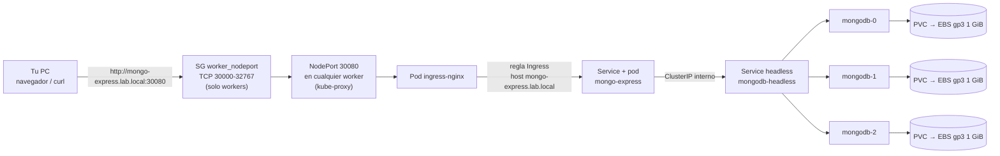

# Laboratorio — Deployment, MongoDB con Helm (StatefulSet + EBS), ingress-nginx y mongo-express

| Campo | Valor |
|---|---|
| Clúster | `dev-k8s` (kubeadm sobre EC2) · `eu-south-2a` · 1 control plane + 2 workers `c7i-flex.large` |
| Validado | 2026-11-25, de principio a fin sobre un despliegue real (`apply` → guía → script → `destroy`) |
| Requisito | [RUNBOOK-k8s-lab.md](../RUNBOOK-k8s-lab.md): Fases 0-2 completadas y `kubectl` apuntando a `dev-k8s` |

> **Regla de oro:** los discos de MongoDB los crea Kubernetes, **no Terraform**, y `terraform destroy` **no los borra**. Al terminar, **siempre** ejecuta en este orden:
> `scripts/k8s-teardown.sh` → `terraform destroy` → `scripts/k8s-teardown.sh --sweep-only` (paso 8).

---

## Índice

0. [Mapa y prerrequisitos](#0-mapa-y-prerrequisitos)
1. [Preparar la infraestructura](#1-preparar-la-infraestructura-una-vez)
2. [Prueba 1 — Deployment](#2-prueba-1--deployment)
3. [Almacenamiento — AWS EBS CSI driver](#3-almacenamiento--aws-ebs-csi-driver)
4. [ingress-nginx](#4-ingress-nginx)
5. [MongoDB con Helm (StatefulSet de 3 réplicas)](#5-mongodb-con-helm-statefulset-de-3-réplicas)
6. [Replica set, persistencia y failover](#6-replica-set-persistencia-y-failover)
7. [mongo-express](#7-mongo-express)
8. [Destrucción sin huérfanos](#8-destrucción-sin-huérfanos)
9. [Resolución de problemas](#9-resolución-de-problemas)
10. [Archivos del laboratorio y fuentes](#10-archivos-del-laboratorio-y-fuentes)

---

## 0. Mapa y prerrequisitos

**Recorrido de una petición a mongo-express:**



| Pieza | Por qué así |
|---|---|
| **NodePort, no LoadBalancer** | El clúster es kubeadm, sin *cloud provider* de AWS. Un Service `LoadBalancer` se quedaría en `<pending>`. Además, sin balanceador no hay coste extra ni recursos huérfanos |
| **Entrada por un worker** | La regla `worker_nodeport` solo existe en el security group de los workers. Por la IP del control plane no responde (validado: *timeout*) |
| **Cualquier worker sirve** | Con `externalTrafficPolicy: Cluster`, kube-proxy reenvía al pod del controlador aunque esté en el otro worker (validado: `404` por las dos IPs) |
| **MongoDB nunca se expone** | Solo tiene Services `ClusterIP`. Desde internet solo se llega a la interfaz web, y con login |
| **EBS CSI driver** | Sin *cloud provider*, Kubernetes no sabe crear discos en AWS. Este driver lo hace |

**Coste** (precios consultados el 2026-11-25 en `eu-south-2a`; el Spot cambia a diario):

| Concepto | USD/h |
|---|---|
| 3 × `c7i-flex.large` Spot (0,0311 c/u) | 0,0933 |
| 3 IPv4 públicas (0,005 c/u) | 0,0150 |
| 3 discos raíz gp3 de 12 GB (0,088 USD/GB-mes) | 0,0043 |
| 3 PVC gp3 de 1 GiB | 0,0004 |
| **Total aproximado** | **≈ 0,113** (sesión de 5 h ≈ 0,57) |

**Prerrequisitos** (en tu PC, dentro de `terraform-bootcamp/`):

```bash
helm version --short
```
```bash
kubectl config current-context
```
```bash
kubectl get nodes
```
| Esperado | Si no |
|---|---|
| `v4.x` · `dev-k8s` · 3 nodos `Ready` | Contexto distinto: `source scripts/setup-kubeconfig.sh`. Clúster no desplegado: paso 1 |

Repositorios de Helm (una sola vez; `update` también arregla los índices viejos de otros repositorios):
```bash
helm repo add aws-ebs-csi-driver https://kubernetes-sigs.github.io/aws-ebs-csi-driver
```
```bash
helm repo add ingress-nginx https://kubernetes.github.io/ingress-nginx
```
```bash
helm repo add cowboysysop https://cowboysysop.github.io/charts/
```
```bash
helm repo update
```
> El chart de MongoDB se descarga por OCI (`oci://registry-1.docker.io/bitnamicharts/mongodb`) y no necesita `repo add`.

---

## 1. Preparar la infraestructura (una vez)

Estos cambios **ya están en el repositorio**. Aquí se explica qué hacen y cómo comprobarlos.

| Archivo | Cambio | Por qué |
|---|---|---|
| `iam.tf` | `aws_iam_role_policy_attachment.worker_ebs_csi` → `AmazonEBSCSIDriverPolicyV2`, **solo en el rol de los workers** | El controlador del driver crea, adjunta y borra discos. Corre solo en los workers porque no tolera el *taint* del control plane. La política V2 solo puede gestionar volúmenes con `ebs.csi.aws.com/cluster=true`, así que no puede borrar los discos raíz |
| `instances.tf` | `metadata_options` (IMDSv2 `required`, `http_put_response_hop_limit = 2`) en todas las instancias | Los pods del driver están a un salto de la máquina y necesitan el servicio de metadatos |
| `variables.tf` / `terraform.tfvars` | `worker_instance_type = "c7i-flex.large"` (4 GB) | Con `t3.small` (2 GB) no caben con margen 3 MongoDB + ingress + driver. Validado con 4 GB: el worker más cargado pide 898 Mi y tiene 2656 Mi de límites (71 %) |

> `terraform.tfvars` no está en git: si clonas el repo de nuevo, vuelve a poner `worker_instance_type = "c7i-flex.large"`.

**1.1 · Planificar** (con el clúster destruido)
```bash
terraform plan -out=tfplan
```
| Esperado | Si no |
|---|---|
| `Plan: 54 to add, 0 to change, 0 to destroy.` (53 de siempre + la política) e `instance_type = "c7i-flex.large"` ×3 | `change`/`destroy` → quedaba estado previo (runbook, Fase 0.2) |

**1.2 · Aplicar y conectar kubectl**
```bash
terraform apply tfplan
```
```bash
source scripts/setup-kubeconfig.sh
```
| Esperado |
|---|
| `Apply complete! Resources: 54 added` y `✅ CLÚSTER LISTO` |
| 3 nodos `Ready` y contexto `* dev-k8s` |

**1.3 · Comprobar IMDS** (opcional)
```bash
aws ec2 describe-instances --profile dev --region eu-south-2 --filters "Name=tag:Name,Values=dev-k8s-*" "Name=instance-state-name,Values=running" --query "Reservations[].Instances[].[Tags[?Key=='Name']|[0].Value,InstanceType,MetadataOptions.HttpTokens,MetadataOptions.HttpPutResponseHopLimit]" --output table
```
| Esperado (validado) |
|---|
| Los 3 nodos con `c7i-flex.large · required · 2` |

---

## 2. Prueba 1 — Deployment

Único manifiesto propio: `k8s/01-nginx-deployment/nginx.yaml` (Deployment de 3 réplicas con recursos y *probes*, más un Service ClusterIP).

**2.1 · Crear el namespace y aplicar**
```bash
kubectl create namespace lab
```
```bash
kubectl apply -f k8s/01-nginx-deployment/nginx.yaml
```
```bash
kubectl -n lab rollout status deploy/nginx --timeout=120s
```
```bash
kubectl -n lab get pods -o wide
```
| Esperado | Por qué |
|---|---|
| `successfully rolled out` y 3 pods `Running` repartidos entre `worker-1` y `worker-2` | El *scheduler* no usa el control plane (tiene *taint*) |

> El namespace no va dentro del manifiesto a propósito: así `kubectl delete -f` nunca puede borrar `lab`, donde luego vivirá MongoDB.

**2.2 · Escalar**
```bash
kubectl -n lab scale deploy/nginx --replicas=5
```
```bash
kubectl -n lab get deploy nginx
```
| Esperado |
|---|
| `READY 5/5` |

**2.3 · Actualización progresiva (*rolling update*)**
```bash
kubectl -n lab set image deploy/nginx nginx=nginx:1.28-alpine
```
```bash
kubectl -n lab rollout status deploy/nginx --timeout=180s
```
```bash
kubectl -n lab rollout history deploy/nginx
```
| Esperado | Por qué |
|---|---|
| Revisiones `1` y `2` | Con `maxUnavailable: 1` / `maxSurge: 1` los pods se sustituyen de uno en uno, sin cortar el servicio |

**2.4 · Volver atrás (*rollback*)**
```bash
kubectl -n lab rollout undo deploy/nginx
```
```bash
kubectl -n lab get deploy nginx -o jsonpath='{.spec.template.spec.containers[0].image}{"\n"}'
```
| Esperado | Nota |
|---|---|
| `nginx:1.27-alpine` | Aparece un *warning* sobre `last-applied-configuration`. Es normal: `undo` cambia el Deployment sin pasar por el archivo. En un proyecto real, el *rollback* se hace volviendo a aplicar la versión anterior del YAML desde git |

**2.5 · Autocuración**
Borra el primer pod de la lista:
```bash
POD=$(kubectl -n lab get pods -l app=nginx -o jsonpath='{.items[0].metadata.name}'); echo "$POD"
```
```bash
kubectl -n lab delete pod "$POD" --wait=false
```
```bash
kubectl -n lab get pods -l app=nginx
```
| Esperado |
|---|
| De nuevo 5 pods `Running`, uno con `AGE` de pocos segundos: el ReplicaSet repone el que falta |

**2.6 · Probar el Service por DNS interno**
```bash
kubectl -n lab run curl-test --rm -i --restart=Never --image=busybox:1.36 -- wget -qO- -T 5 http://nginx
```
| Esperado |
|---|
| HTML con `<title>Welcome to nginx!</title>` |

**2.7 · Limpiar la prueba** (el namespace `lab` se queda)
```bash
kubectl delete -f k8s/01-nginx-deployment/nginx.yaml
```

---

## 3. Almacenamiento — AWS EBS CSI driver

Valores: `k8s/aws-ebs-csi-driver/custom-values.yaml`.

| Valor | Qué hace |
|---|---|
| `controller.region: eu-south-2` | Región fija |
| `controller.replicaCount: 1` | Ahorra memoria (de serie son 2) |
| `controller.extraVolumeTags` | Etiqueta **cada disco** con `Project=dev-k8s` y `ManagedBy=aws-ebs-csi-driver`. El script de destrucción busca los huérfanos por estas etiquetas |
| `storageClasses` → `gp3` | StorageClass **por defecto**: gp3, cifrada, `WaitForFirstConsumer` (el disco se crea en la AZ del pod), `reclaimPolicy: Delete` (al borrar el PVC se borra el disco) y ampliable |

**3.1 · Instalar**
```bash
helm upgrade --install aws-ebs-csi-driver aws-ebs-csi-driver/aws-ebs-csi-driver --kube-context dev-k8s --namespace kube-system --version 2.68.1 -f k8s/aws-ebs-csi-driver/custom-values.yaml --wait --timeout 5m
```
El chart muestra notas sobre las políticas V2 y las imágenes `-fips`. Son informativas: ya usamos la V2.

**3.2 · Comprobar**
```bash
kubectl -n kube-system get pods -l app.kubernetes.io/name=aws-ebs-csi-driver -o wide
```
```bash
kubectl get storageclass
```
| Esperado (validado) | Por qué |
|---|---|
| 1 `ebs-csi-controller-…` `5/5` en un **worker** y 3 `ebs-csi-node-…` `3/3`, uno por nodo | El agente de nodo tolera todos los *taints* y lee los metadatos por IMDS (log: `Retrieved metadata from IMDS`) |
| `gp3 (default)   ebs.csi.aws.com   Delete   WaitForFirstConsumer   true` | StorageClass creada por el chart |

**3.3 · Prueba rápida de disco** (opcional, ~1 min)
```bash
kubectl -n lab create -f - <<'EOF'
apiVersion: v1
kind: PersistentVolumeClaim
metadata: {name: pvc-test}
spec: {accessModes: [ReadWriteOnce], resources: {requests: {storage: 1Gi}}}
---
apiVersion: v1
kind: Pod
metadata: {name: pvc-test}
spec:
  containers:
  - name: app
    image: busybox:1.36
    command: ["sh", "-c", "echo hola > /data/f && cat /data/f && sleep 3600"]
    volumeMounts: [{name: d, mountPath: /data}]
  volumes: [{name: d, persistentVolumeClaim: {claimName: pvc-test}}]
EOF
```
```bash
kubectl -n lab wait pod/pvc-test --for=condition=Ready --timeout=180s
```
```bash
kubectl -n lab get pvc pvc-test
```
```bash
aws ec2 describe-volumes --profile dev --region eu-south-2 --filters Name=tag:Project,Values=dev-k8s Name=tag:ManagedBy,Values=aws-ebs-csi-driver --query "Volumes[].[VolumeId,Size,VolumeType,Encrypted,State]" --output table
```
| Esperado (validado) |
|---|
| PVC `Bound` de `1Gi` en `gp3` y, en AWS, un volumen `1 · gp3 · True · in-use` con las etiquetas `Project`, `ManagedBy` y `ebs.csi.aws.com/cluster=true` |

Borrar la prueba y comprobar que el disco desaparece de AWS:
```bash
kubectl -n lab delete pod pvc-test
```
```bash
kubectl -n lab delete pvc pvc-test
```
```bash
kubectl get pv
```
| Esperado (validado) |
|---|
| `No resources found` y, en AWS, el volumen ya no existe (`InvalidVolume.NotFound`) |

---

## 4. ingress-nginx

Valores: `k8s/ingress-nginx/custom-values.yaml`.

> ⚠️ ingress-nginx **se retiró en marzo de 2026**: no habrá más parches de seguridad. Úsalo solo en este laboratorio temporal.

| Valor | Qué hace |
|---|---|
| `controller.service.type: NodePort` | Sin balanceador de AWS |
| `nodePorts.http: 30080` / `https: 30443` | Puertos fijos dentro del rango que abre `worker_nodeport` (30000-32767). El rango NodePort de Kubernetes es el de serie, porque `kubeadm init` no lo cambia |
| `externalTrafficPolicy: Cluster` | Cualquier worker acepta la petición y kube-proxy la reenvía |
| `replicaCount: 1` y `resources` | Mínimo necesario |

**4.1 · Instalar**
```bash
helm upgrade --install ingress-nginx ingress-nginx/ingress-nginx --kube-context dev-k8s --namespace ingress-nginx --create-namespace --version 4.15.1 -f k8s/ingress-nginx/custom-values.yaml --wait --timeout 5m
```

**4.2 · Comprobar**
```bash
kubectl -n ingress-nginx get svc ingress-nginx-controller
```
```bash
kubectl get ingressclass
```
| Esperado |
|---|
| `NodePort   …   80:30080/TCP,443:30443/TCP` e IngressClass `nginx` |

**4.3 · Probar desde tu PC por los dos workers**
```bash
terraform output worker_public_ips
```
```bash
curl -s -o /dev/null -w "%{http_code}\n" http://<IP_worker_1>:30080/
```
```bash
curl -s -o /dev/null -w "%{http_code}\n" http://<IP_worker_2>:30080/
```
| Esperado (validado) | Por qué |
|---|---|
| `404` por las **dos** IPs | Es la respuesta de nginx sin reglas: el controlador funciona. Responde también el worker que no tiene el pod |
| Por la IP del **control plane**: sin respuesta (`000`, *timeout*) | Su security group no tiene regla NodePort. Es correcto |

---

## 5. MongoDB con Helm (StatefulSet de 3 réplicas)

Valores: `k8s/mongodb/custom-values.yaml`.

> ⚠️ **Por qué la versión 16.5.45 y `bitnamilegacy`:** desde el 28-ago-2025 Bitnami solo publica gratis sus imágenes antiguas en `docker.io/bitnamilegacy/`, congeladas y **sin parches de seguridad**. El chart actual (20.x) usa imágenes nuevas de pago. La **16.5.45** es la última versión del chart cuyas imágenes de serie (`mongodb:8.0.13-debian-12-r0` y sus auxiliares) existen en `bitnamilegacy`. **No subas la versión** sin revisar el archivo de valores. Válido solo para laboratorio.

| Valor | De serie | Laboratorio | Por qué |
|---|---|---|---|
| `architecture` | `standalone` | `replicaset` | StatefulSet con replica set |
| `replicaCount` | `2` | `3` | 3 miembros con datos |
| `arbiter.enabled` | `true` | `false` | Con 3 miembros no hace falta árbitro |
| `persistence.storageClass` / `size` | `""` / `8Gi` | `gp3` / `1Gi` | Mínimo de gp3: menos coste |
| `resources` | preset `small` | 250m/256Mi → 500m/512Mi | Acotado y conocido |
| Imágenes (`image`, `tls`, `externalAccess`, `volumePermissions`, `metrics`) | `bitnami/*` | `bitnamilegacy/*`, mismas etiquetas | Las únicas gratuitas |
| `externalAccess.enabled` | `false` | `false` (explícito) | MongoDB nunca se expone fuera |

**Contraseñas:** no van en el archivo. El chart genera la de root y la guarda en el Secret `mongodb`, clave `mongodb-root-password`.

**5.1 · Instalar** (tarda ~2-3 min: los miembros arrancan de uno en uno)
```bash
helm upgrade --install mongodb oci://registry-1.docker.io/bitnamicharts/mongodb --kube-context dev-k8s --namespace lab --create-namespace --version 16.5.45 -f k8s/mongodb/custom-values.yaml --wait --timeout 10m
```
| Esperado (validado) | Por qué |
|---|---|
| `STATUS: deployed` con varios `⚠ WARNING` (imágenes sustituidas, catálogo gratuito limitado) | Son avisos, no errores: todas las imágenes son `bitnamilegacy`, así que el chart no falla y **no hace falta** `global.security.allowInsecureImages` |

**5.2 · Comprobar**
```bash
kubectl -n lab get sts,pods,pvc -o wide
```
| Esperado (validado) | Por qué |
|---|---|
| `statefulset.apps/mongodb 3/3` · pods `mongodb-0`, `mongodb-1`, `mongodb-2` `Running` | Nombres estables y ordenados: propio de un StatefulSet |
| PVC `datadir-mongodb-0/1/2` `Bound`, `1Gi`, `gp3` | Un disco por réplica (`volumeClaimTemplates`) |
| Reparto validado: `mongodb-0` en `worker-1`; `mongodb-1` y `mongodb-2` en `worker-2` | Con 2 workers y anti-afinidad **blanda** (de serie), un worker aloja 2 réplicas. Si cae ese worker, el replica set se queda **sin mayoría** (1 de 3) y sin primario hasta que vuelvan |

Los 3 discos en AWS:
```bash
aws ec2 describe-volumes --profile dev --region eu-south-2 --filters Name=tag:Project,Values=dev-k8s Name=tag:ManagedBy,Values=aws-ebs-csi-driver --query "Volumes[].[VolumeId,Size,State,Tags[?Key=='kubernetes.io/created-for/pvc/name']|[0].Value]" --output table
```
| Esperado |
|---|
| 3 volúmenes de `1` GiB `in-use`, uno por cada `datadir-mongodb-N` |

---

## 6. Replica set, persistencia y failover

**6.1 · Leer la contraseña de root** (queda solo en esta terminal)
```bash
export MONGODB_ROOT_PASSWORD=$(kubectl -n lab get secret mongodb -o jsonpath='{.data.mongodb-root-password}' | base64 -d)
```

**6.2 · Estado del replica set**
```bash
kubectl -n lab exec mongodb-0 -c mongodb -- mongosh --quiet -u root -p "$MONGODB_ROOT_PASSWORD" --authenticationDatabase admin --eval 'rs.status().members.forEach(m => print(m.name.split(".")[0], m.stateStr))'
```
| Esperado (validado) |
|---|
| Un `PRIMARY` y dos `SECONDARY` (validado: `mongodb-0 PRIMARY`) |

**6.3 · Escribir un dato** (en el PRIMARY; si no es `mongodb-0`, cambia el nombre)
```bash
kubectl -n lab exec mongodb-0 -c mongodb -- mongosh --quiet -u root -p "$MONGODB_ROOT_PASSWORD" --authenticationDatabase admin --eval 'db.getSiblingDB("lab").pruebas.insertOne({msg:"hola persistencia"}); print(db.getSiblingDB("lab").pruebas.countDocuments())'
```
| Esperado |
|---|
| `1` |

**6.4 · Anotar el disco del PRIMARY**
```bash
kubectl get pv $(kubectl -n lab get pvc datadir-mongodb-0 -o jsonpath='{.spec.volumeName}') -o jsonpath='{.spec.csi.volumeHandle}{"\n"}'
```
Apunta el `vol-…`.

**6.5 · Provocar un failover: borrar el pod PRIMARY**
```bash
kubectl -n lab delete pod mongodb-0 --wait=false
```
Espera ~25 s y mira el estado desde otro miembro:
```bash
kubectl -n lab exec mongodb-1 -c mongodb -- mongosh --quiet -u root -p "$MONGODB_ROOT_PASSWORD" --authenticationDatabase admin --eval 'rs.status().members.forEach(m => print(m.name.split(".")[0], m.stateStr))'
```
| Esperado (validado) | Por qué |
|---|---|
| Otro miembro es `PRIMARY` (validado: `mongodb-1`) y `mongodb-0` vuelve como `SECONDARY` | Los dos miembros que quedan son mayoría (2 de 3) y eligen un primario nuevo |

**6.6 · El pod vuelve con su mismo disco y su dato**
```bash
kubectl -n lab wait pod/mongodb-0 --for=condition=Ready --timeout=300s
```
```bash
kubectl get pv $(kubectl -n lab get pvc datadir-mongodb-0 -o jsonpath='{.spec.volumeName}') -o jsonpath='{.spec.csi.volumeHandle}{"\n"}'
```
```bash
kubectl -n lab exec mongodb-0 -c mongodb -- mongosh --quiet -u root -p "$MONGODB_ROOT_PASSWORD" --authenticationDatabase admin --eval 'db.getMongo().setReadPref("secondaryPreferred"); printjson(db.getSiblingDB("lab").pruebas.findOne({},{_id:0,msg:1}))'
```
| Esperado (validado) | Por qué |
|---|---|
| **El mismo `vol-…`** que en 6.4 y `{ msg: 'hola persistencia' }` | El StatefulSet vuelve a crear `mongodb-0` y lo enlaza con **su** PVC `datadir-mongodb-0`. El dato vive en el disco EBS, no en el pod |
| Al rato, `mongodb-0` puede volver a ser `PRIMARY` | Validado: se reeligió solo |

---

## 7. mongo-express

Valores: `k8s/mongo-express/custom-values.yaml` (chart comunitario `cowboysysop/mongo-express` 7.0.0, imagen oficial `mongo-express:1.0.2`).

> ⚠️ mongo-express está **descontinuado**: solo para pruebas. Como el rango NodePort está abierto a internet, **cualquiera con la IP llega a la pantalla de login**: por eso la contraseña web es obligatoria y aleatoria, y el clúster se destruye al acabar la sesión.

| Valor | Qué hace |
|---|---|
| `mongodbServer` | Los 3 miembros (`mongodb-N.mongodb-headless.lab.svc.cluster.local`). El driver descubre el replica set y sigue al primario (validado tras un failover) |
| `mongodbEnableAdmin: true` / `mongodbAdminUsername: root` | Conexión como root. La contraseña llega con `--set` |
| `basicAuthUsername: admin` | Login de la web. La contraseña llega con `--set` |
| `ingress` | `ingressClassName: nginx`, host `mongo-express.lab.local`, ruta `/` |

> **Por qué `--set` y no `existingSecret: mongodb`:** el chart leería de ese Secret también `site-cookie-secret`, `site-session-secret` y `basic-auth-password`, que no existen, y el pod no arrancaría.

**7.1 · Preparar las contraseñas** (en la misma terminal del paso 6)
```bash
export MONGODB_ROOT_PASSWORD=$(kubectl -n lab get secret mongodb -o jsonpath='{.data.mongodb-root-password}' | base64 -d)
```
```bash
export ME_WEB_PASSWORD=$(openssl rand -base64 18 | tr -d '/+=' | cut -c1-20)
```
```bash
echo "$ME_WEB_PASSWORD"
```
Apúntala: es tu contraseña de la web (usuario `admin`). Si la pierdes, la recuperas con:
```bash
kubectl -n lab get secret mongo-express -o jsonpath='{.data.basic-auth-password}' | base64 -d; echo
```

**7.2 · Instalar**
```bash
helm upgrade --install mongo-express cowboysysop/mongo-express --kube-context dev-k8s --namespace lab --version 7.0.0 -f k8s/mongo-express/custom-values.yaml --set mongodbAdminPassword="$MONGODB_ROOT_PASSWORD" --set basicAuthPassword="$ME_WEB_PASSWORD" --wait --timeout 5m
```
```bash
kubectl -n lab get pods,ingress
```
| Esperado |
|---|
| Pod `mongo-express-…` `Running` e Ingress `mongo-express   nginx   mongo-express.lab.local` |

**7.3 · Probar con curl** (sustituye la IP por la de un worker)
```bash
curl -s -o /dev/null -w "%{http_code}\n" -H "Host: mongo-express.lab.local" http://<IP_worker>:30080/
```
```bash
curl -s -o /dev/null -w "%{http_code}\n" -u "admin:$ME_WEB_PASSWORD" -H "Host: mongo-express.lab.local" http://<IP_worker>:30080/
```
| Esperado (validado por los dos workers) | Por qué |
|---|---|
| `401` sin login y `200` con login | El ingress envía por el host a mongo-express, y este exige autenticación |
| Sin la cabecera `Host`: `404` | Ninguna regla Ingress coincide |

**7.4 · Abrir en el navegador**

Añade el nombre a tu `/etc/hosts` con la IP de un worker (cambia en cada despliegue):
```bash
echo "<IP_worker> mongo-express.lab.local" | sudo tee -a /etc/hosts
```
Abre `http://mongo-express.lab.local:30080`, entra con `admin` / tu contraseña y verás la base de datos `lab` con la colección `pruebas`.

---

## 8. Destrucción sin huérfanos

Script: `scripts/k8s-teardown.sh`. Usa **siempre** el contexto `dev-k8s` (nunca toca minikube).

| Fase | Qué hace |
|---|---|
| 1 · Kubernetes (si el clúster responde) | `helm uninstall` de mongo-express, mongodb e ingress-nginx. Borra el Deployment de prueba. **Borra los PVC** (`helm uninstall` no borra los de un StatefulSet). Espera a que el driver borre los discos (máx. 5 min). Desinstala el driver el último y borra los namespaces. Avisa si hay algún Service `LoadBalancer` |
| 2 · AWS (siempre) | Busca discos y snapshots con `Project=dev-k8s` + `ManagedBy=aws-ebs-csi-driver`. Borra los `available` (pide confirmación o usa `--yes`). Los discos raíz de Terraform no llevan esas etiquetas |
| Resultado | Código `0` si no queda nada; `1` si queda algo |

**8.1 · Con el clúster vivo**
```bash
scripts/k8s-teardown.sh
```
| Esperado (validado, ~1 min 20 s) |
|---|
| `✅ helm uninstall …` ×3, 3 `PVC … borrado`, `✅ Sin PVs de EBS`, `✅ helm uninstall aws-ebs-csi-driver`, namespaces eliminados y `✅ Nada pendiente en AWS fuera de Terraform` |

**8.2 · Destruir la infraestructura**
```bash
terraform destroy
```
| Esperado |
|---|
| `Destroy complete! Resources: 54 destroyed.` |

**8.3 · Barrido final**
```bash
scripts/k8s-teardown.sh --sweep-only
```
| Esperado | Si no |
|---|---|
| `✅ Nada pendiente en AWS fuera de Terraform` (código 0) | Lista los discos huérfanos y pregunta si borrarlos. Sin terminal interactiva no borra y devuelve código 1: repite con `--yes`. Validado con un huérfano simulado: lo detecta y, con `--yes`, lo borra |

**8.4 · Limpieza local**
```bash
sudo sed -i '/mongo-express.lab.local/d' /etc/hosts
```
```bash
kubectl config use-context minikube
```

> **¿Y si ejecuté `terraform destroy` sin el paso 8.1?** Los discos de MongoDB se quedan `available` y cobrando. `scripts/k8s-teardown.sh --sweep-only` los encuentra por sus etiquetas y los borra.

---

## 9. Resolución de problemas

| Síntoma | Causa probable | Solución |
|---|---|---|
| PVC en `Pending` con `waiting for first consumer` | Normal con `WaitForFirstConsumer` hasta que un pod lo usa | Crea el pod o espera a que arranque |
| PVC en `Pending` con errores de `CreateVolume` / `UnauthorizedOperation` | Falta la política en el rol de los workers | `terraform plan` debe incluir `worker_ebs_csi`; `kubectl -n kube-system logs deploy/ebs-csi-controller -c ebs-plugin` |
| Logs del driver con `context deadline exceeded` al leer metadatos | IMDS inaccesible desde el pod (salto 1) | Comprueba 1.3: debe salir `required · 2` |
| `helm show` o `helm upgrade` con `no cached repo found … index.yaml` | Índice de un repositorio de Helm no descargado | `helm repo update` |
| `ImagePullBackOff` en MongoDB | Imagen `bitnami/…` en vez de `bitnamilegacy/…`, o versión del chart distinta de 16.5.45 | Usa exactamente el comando 5.1 con `--version 16.5.45` y el `custom-values.yaml` del repo |
| Error `Original containers have been substituted…` que **detiene** la instalación | Alguna imagen no es de `bitnamilegacy` | Revisa que las 5 imágenes del archivo de valores apunten a `bitnamilegacy` |
| Pods de MongoDB en `Pending` por `Insufficient memory` | Workers de 2 GB | `worker_instance_type = "c7i-flex.large"` (paso 1) |
| `curl` a `:30080` sin respuesta | IP del control plane, o IP antigua | Usa `terraform output worker_public_ips` |
| `404` en mongo-express | Falta la cabecera `Host` o la línea de `/etc/hosts` | 7.3 / 7.4 |
| `503` en mongo-express | Pod de mongo-express no listo | `kubectl -n lab get pods`; `kubectl -n lab logs deploy/mongo-express` |
| mongo-express no conecta | Contraseña de root mal pasada | Repite 7.1 y 7.2 en la misma terminal |
| `rs.status()` sin `PRIMARY` | Solo queda 1 de 3 miembros (por ejemplo, se cayó el worker con 2 réplicas) | Espera a que vuelvan los pods: `kubectl -n lab get pods -w` |
| El barrido dice que un disco está `in-use` | El clúster sigue vivo con ese PVC | Ejecuta `scripts/k8s-teardown.sh` (sin `--sweep-only`) |

---

## 10. Archivos del laboratorio y fuentes

| Archivo | Contenido |
|---|---|
| `k8s/01-nginx-deployment/nginx.yaml` | Único manifiesto: Deployment + Service de prueba |
| `k8s/aws-ebs-csi-driver/custom-values.yaml` | Driver EBS 2.68.1: región, etiquetas y StorageClass `gp3` |
| `k8s/ingress-nginx/custom-values.yaml` | ingress-nginx 4.15.1: NodePort 30080/30443 |
| `k8s/mongodb/custom-values.yaml` | MongoDB 16.5.45: replica set de 3, `bitnamilegacy`, gp3 1 GiB |
| `k8s/mongo-express/custom-values.yaml` | mongo-express 7.0.0: replica set, login e Ingress |
| `scripts/k8s-teardown.sh` | Destrucción de lo que Terraform no controla |
| `iam.tf`, `instances.tf`, `variables.tf` | Política EBS CSI, IMDS y tipo de worker |

Cada `custom-values.yaml` lleva en su cabecera el chart, la versión fijada y el comando de instalación.

**Fuentes:**
- [AWS EBS CSI driver](https://github.com/kubernetes-sigs/aws-ebs-csi-driver) · [Política `AmazonEBSCSIDriverPolicyV2`](https://docs.aws.amazon.com/aws-managed-policy/latest/reference/AmazonEBSCSIDriverPolicyV2.md) · [Migración a las políticas V2 (issue 2918, citado en las notas del chart)](https://github.com/kubernetes-sigs/aws-ebs-csi-driver/issues/2918)
- [`bitnamilegacy/mongodb` en Docker Hub](https://hub.docker.com/r/bitnamilegacy/mongodb) · [Verificación de imágenes en los charts de Bitnami (issue 30850, citado en el propio chart)](https://github.com/bitnami/charts/issues/30850)
- [Retirada de ingress-nginx (blog de Kubernetes)](https://kubernetes.io/blog/2025/11/11/ingress-nginx-retirement/)
- [Repositorio de charts `cowboysysop`](https://cowboysysop.github.io/charts/)
